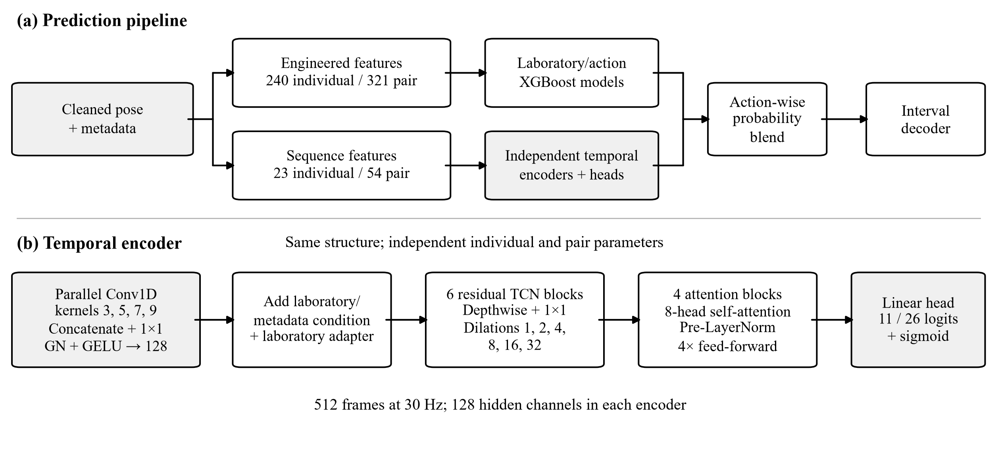

# MABe Challenge: Social Action Recognition in Mice

### Combining engineered motion features with learned temporal representations

**SC4000 Research Project · Group 54 · Nanyang Technological University**  
College of Computing and Data Science

**Chew Yee Chen · Jovan Tan Chun Ee · Law Zhi Xuan · Xu Zixuan**  
All authors contributed equally.

**[Read the research paper](Group54_report.pdf) · [Watch the YouTube presentation](https://youtu.be/DdzohzUmGj0) · [Kaggle competition](https://www.kaggle.com/competitions/MABe-mouse-behavior-detection)**

## Overview

Recognizing mouse behaviour from pose trajectories requires a model to distinguish similar movements despite incomplete annotations, rare actions, and differences between recording laboratories. This project investigates whether explicitly engineered motion and interaction features complement representations learned directly from pose sequences.

Our system combines laboratory-specific **XGBoost classifiers** with a **temporal convolution-attention network**, then converts their blended frame probabilities into behaviour intervals. The selected ensemble achieves **0.470192 local development F1**, compared with **0.376471** for the decoded tree branch and **0.421040** for the temporal branch. The strongest finding is the benefit of combining the two representations; an equal-weight blend already reaches **0.469314**.

This repository contains the data-processing pipeline, model implementations, experiment configurations, evaluation code, and offline Kaggle inference notebook. The [final report](Group54_report.pdf) presents the full study, and the [group presentation](https://youtu.be/DdzohzUmGj0) explains the approach and findings.

## Research approach



*The two temporal encoders share an architecture but learn independent weights for individual mice and directed mouse pairs.*

### 1. Valid supervision and standardized poses

The inputs are two-dimensional pose tracks and video metadata. The outputs identify **who performs an action, toward which target, and over which frames**. Individual actions use a self target; social actions preserve the direction of the agent-target pair.

An absent annotation is a negative example only when the video's annotation mask confirms that the corresponding agent-target-action combination was reviewed. Unreviewed combinations are excluded from supervised losses and scoring. The pipeline audits labels, groups duplicate recordings, maps heterogeneous skeletons to ten canonical landmarks, flags unreliable tracking, and interpolates short gaps. Physical coordinates are used when the recorded scale is valid; missingness and quality indicators remain available to the models.

### 2. Complementary tree and temporal representations

| Component | XGBoost branch | Temporal branch |
|---|---|---|
| Representation | 240 individual / 321 directed-pair engineered features | 23 individual / 54 directed-pair input channels |
| Motion context | Geometry, kinematics, posture, egocentric relations, group context, and summaries over 0.1–5 s | 512-frame windows at 30 Hz, approximately 17.1 s |
| Model | Binary classifiers for supported laboratory-action combinations | Independent individual and pair convolution-attention encoders |
| Training data | Primary competition laboratories | Primary laboratories plus eligible labelled auxiliary videos |
| Output | Per-frame action probabilities | 11 individual and 26 pair-action probabilities per frame |

The tree branch uses [XGBoost](https://arxiv.org/abs/1603.02754) with sampled positives, near-boundary negatives, and background negatives. Inner-fold early stopping selects the tree count before refitting on all outer-training folds. Feature ablations, predefined hyperparameter candidates, hard-negative mining, and alternative boosting families are evaluated during development.

Each temporal encoder applies parallel convolutions with kernel sizes **3, 5, 7, and 9**, projects to **128 channels**, and adds laboratory and metadata conditioning. This is followed by **six residual temporal convolution blocks** with dilations **1, 2, 4, 8, 16, and 32**, then **four self-attention blocks with eight heads each**. Separate linear heads produce the action logits. The evaluated model has **1,915,749 trainable parameters**; its configuration disables the optional recurrent layer. See [the model implementation](src/mabe/temporal_model.py) and [temporal configuration](configs/temporal-performance.yaml).

Training uses masked, laboratory-weighted focal BCE plus a macro soft-F1 penalty:

$$
\mathcal{L}=\mathcal{L}_{\mathrm{focal}}+0.20\,\mathcal{L}_{\mathrm{soft\text{-}F1}}.
$$

The focal exponent is **2.0**, and positive BCE terms receive weight **1.5**. This adapts the focusing principle of [Lin et al.](https://arxiv.org/abs/1708.02002); the positive-only weighting differs from their original alpha-balanced convention. The soft-F1 coefficient is a configured training choice. Both terms exclude invalid supervision. Pose augmentation, same-laboratory MixUp and temporal CutMix, AdamW, warm-up and cosine decay, and exponential moving-average parameters complete the training procedure.

### 3. Probability blending and interval decoding

For each action, the selected system combines the two probability streams using a convex weight. Weights are fitted on other-fold predictions, with estimates for sparsely supported actions shrunk toward a global weight. Comparisons include equal, global, action, laboratory, and laboratory-action weighting, a laboratory selector, and a nonlinear probability stacker.

The decoder smooths probabilities, applies hysteresis, resolves competing actions for each directed mouse pair, forms contiguous intervals, removes short intervals, and merges small gaps when another action does not intervene. Predictions use half-open intervals, **[start frame, stop frame)**, in the original video's frame numbering. Different targets may receive predictions simultaneously, but a directed pair has at most one action per frame.

### 4. Offline inference

Temporal inference uses **512-frame windows with stride 128**, weighted overlap averaging, and reflection test-time augmentation. Predictions from the five fold models are averaged within each branch before blending and decoding. Videos are processed individually, and the notebook verifies bundled file hashes before producing `submission.csv`. The model uses surrounding temporal context and is intended for offline analysis.

## Data and evaluation

The study uses the [MABe Challenge competition data](https://www.kaggle.com/competitions/MABe-mouse-behavior-detection). The audited local dataset contains:

| Dataset component | Count / use |
|---|---|
| Training metadata entries | 8,789 videos |
| Videos with usable annotations | 847 |
| Primary evaluation subset | 352 videos from 15 laboratories |
| Labelled auxiliary subset | 495 videos; training only for the temporal branch |
| Unlabelled MABe22 subset | 7,926 videos; excluded from this supervised training pipeline |
| Other excluded records | 15 without usable masks and 1 ambiguous record |
| Canonical action vocabulary | 37 actions: 11 individual and 26 directed-pair actions |
| Primary validation fold sizes | 70 / 73 / 70 / 68 / 71 videos |

Five fixed, video-grouped folds keep all frames, mice, and directed pairs from the same video together. Detected duplicate groups also remain within a fold. Both branches are evaluated on the same primary subset, with **106,642,451 aligned frame-entity-action rows** in their out-of-fold prediction tables.

Evaluation follows the [competition scorer](src/mabe/metric.py): frame-level true positives, false positives, and false negatives are accumulated per laboratory and action, then F1 is averaged over ground-truth-supported actions within each laboratory and over laboratories. Predictions outside reviewed combinations are ignored. The configured F-beta metric uses **beta = 1**; it is distinct from the differentiable soft-F1 training loss and the average-precision screening metric.

## Results and interpretation

### Local development results

The following values come from the saved **performance-v2** experiment reports. They are development results, not hidden-test scores. Each complete candidate uses its own fitted decoder.

| Model / configuration | Competition F1 | Role |
|---|---:|---|
| Initial XGBoost baseline | 0.371042 | Starting baseline |
| XGBoost with selected decoder | 0.376471 | Tree reference |
| Temporal convolution-attention model | 0.421040 | Sequence reference |
| Equal-weight tree + temporal blend | 0.469314 | Simple ensemble comparison |
| **Action-wise tree + temporal blend** | **0.470192** | **Selected deployment model** |
| Global blend | 0.471882 | Diagnostic comparison |
| Laboratory blend | 0.462610 | Diagnostic comparison |
| Laboratory-action blend | 0.461637 | Diagnostic comparison |
| Per-laboratory selector | 0.470459 | Diagnostic comparison |
| Nonlinear probability stacker | 0.454654 | Eligible, not selected |

The selected blend gains **0.093721** over decoded trees and **0.049152** over the temporal branch. Its improvement over equal weighting is only **0.000877**. These comparisons support complementary information in the two branches, with weaker evidence for the extra action-specific weighting complexity.

The global blend scores highest among the evaluated candidates. Deployment selection was restricted to the tree reference, action-wise blend, and stacker, so the chosen system is the strongest eligible candidate rather than the highest-scoring diagnostic. The global blend was not rejected for failing the runtime gate.

Evidence is stored locally in:

- `artifacts/xgb/xgb-performance-v2/cv_report.json`
- `artifacts/phase8/gbdt-performance-v2/phase8_report.json`
- `artifacts/temporal/temporal-performance-v2/phase9_report.json`
- `artifacts/phase11/ensemble-performance-v2/phase11_report.json`
- `artifacts/phase11/ensemble-performance-v2/candidate_leaderboard.csv`

### Kaggle results reported in the paper

The [final report, Section 1.4](Group54_report.pdf) reports a **public score of 0.47815** and a **rank of 82 out of 1,412 teams**. These are paper-reported figures. The embedded leaderboard row displays a different score, **0.47806**, and this checkout has no committed Kaggle submission record tying the score, team, and rank together. The reported ranking therefore remains unverified against a matching submission record.

### Runtime and limitations

A saved local inference run processed **one public test video in 45.13 s**, producing **339 intervals**, with no failed videos or output validation errors. This is a single-recording execution check; extrapolation to the full hidden set is not a measured benchmark. The evidence is in `artifacts/phase12/runtime-performance-v2/inference_report.json`.

The main limits on interpretation are:

- **Selection and evaluation remain dependent.** Temporal checkpoints are selected using the evaluated fold. Downstream cross-fitting excludes that fold's labels directly, but other-fold predictions can come from base models trained on it. The scores are development estimates, not a fully nested independent evaluation; see [Cawley and Talbot](https://www.jmlr.org/papers/v11/cawley10a.html).
- **Training data differ between branches.** The temporal model receives auxiliary labelled data, so the comparison measures complete pipelines rather than isolating architecture alone.
- **Small differences need stronger evidence.** The experiments do not establish statistical significance for the action-wise versus equal-weight gain, or unseen-laboratory generalization.
- **Deployment includes a laboratory-specific policy.** The current configuration drops AdaptableSnail predictions at 25 fps. This setting comes from an earlier local comparison and was not isolated in the performance-v2 result table; see [the active inference configuration](configs/inference-performance.yaml).

## Reproducing the study

### Environment and data

The package declares support for **Python 3.12–3.14**. Main dependencies include PyTorch, XGBoost, NumPy, Polars, pandas, PyArrow, and scikit-learn; version ranges are in [requirements.txt](requirements.txt) and [pyproject.toml](pyproject.toml). CUDA is strongly recommended for temporal training. The full experiment workflow also requires LightGBM and CatBoost for the alternative-model screen; these are included in [requirements-optional.txt](requirements-optional.txt). They are not required for inference with the selected XGBoost–temporal ensemble.

Create an environment from the repository root:

```powershell
# Windows PowerShell
python -m venv .venv
.\.venv\Scripts\Activate.ps1
python -m pip install --upgrade pip
python -m pip install -r requirements.txt
python -m pip install -r requirements-optional.txt
python -m pip install --no-deps --editable .
```

On Linux, use `python3 -m venv .venv` and `source .venv/bin/activate`, then run the same installation commands. Check the selected PyTorch installation before training:

```bash
python -c "import torch; print('CUDA available:', torch.cuda.is_available())"
```

Download the competition data through Kaggle and place it in `MABe-mouse-behavior-detection/` at the repository root. [configs/base.yaml](configs/base.yaml) sets `dataset_root: ../MABe-mouse-behavior-detection`, resolved relative to the configuration file. Alternatively, set `MABE_DATASET_ROOT` to an absolute dataset path.

**Competition data, generated caches, trained weights, and bundles are excluded from version control.** The artifact paths below describe outputs in the local research workspace; a fresh checkout needs the data and either regenerated artifacts or a separately supplied trained bundle.

### Prepare the data

Run from the repository root with the environment activated:

```bash
python -m mabe audit-data --config configs/base.yaml
python -m mabe build-labels --config configs/base.yaml
python -m mabe build-folds --config configs/base.yaml
python -m mabe build-poses --config configs/base.yaml --pose-config configs/pose.yaml
python -m mabe build-features --config configs/base.yaml --pose-config configs/pose.yaml --feature-config configs/features.yaml
```

### Train and evaluate

Run the stages in order. These commands reproduce the configured performance-v2 workflow; training is required and results can vary with the execution environment.

```bash
# Tree baseline
python -m mabe train-xgb-baseline --config configs/base.yaml --pose-config configs/pose.yaml --feature-config configs/features.yaml --xgboost-config configs/xgboost-performance.yaml

# Tree screening, retraining, and decoder selection
python -m mabe strengthen-gbdt --config configs/base.yaml --phase8-config configs/phase8-performance.yaml --pose-config configs/pose.yaml --feature-config configs/features.yaml --xgboost-config configs/xgboost-performance.yaml

# Temporal model and out-of-fold predictions
python -m mabe train-temporal --config configs/base.yaml --temporal-config configs/temporal-performance.yaml --pose-config configs/pose.yaml --phase8-config configs/phase8-performance.yaml

# Ensemble comparisons and deployment selection
python -m mabe ensemble-oof --config configs/base.yaml --phase11-config configs/ensemble-performance.yaml
```

The temporal run first checks fold 0 against a configured validation-AP gate before continuing to the other folds. Matching saved checkpoints can be reused when restarting. Inspect the reports listed above after each stage. The final ensemble report records `selected_model_id`, `final_exact_fbeta`, `candidate_scores`, and `runtime_feasible`.

### Configure new experiments

| Configuration | Controls |
|---|---|
| [pose.yaml](configs/pose.yaml), [features.yaml](configs/features.yaml) | Pose normalization, quality checks, engineered representations |
| [xgboost-performance.yaml](configs/xgboost-performance.yaml) | Tree capacity, regularization, sampling, and early stopping |
| [phase8-performance.yaml](configs/phase8-performance.yaml) | Feature/model screens and tree decoder search |
| [temporal-performance.yaml](configs/temporal-performance.yaml) | Architecture, sampling, loss, augmentation, optimizer, and inference windows |
| [ensemble-performance.yaml](configs/ensemble-performance.yaml) | Blend scopes, stacker, decoder fitting, and selection gates |
| [inference-performance.yaml](configs/inference-performance.yaml) | Artifact routes, fold aggregation, runtime budget, and special-case policy |

Use a new, consistent version suffix for each experiment and update dependent artifact paths together. Rebuild preprocessing when data, pose, or feature definitions change; model-only changes require rerunning the affected training and downstream stages. The active path here is **performance-v2**. Older v1/v7 examples in auxiliary documentation and the historical release configuration do not identify the current bundle.

## Offline inference and Kaggle submission

The current local submission pair is:

| Item | Location |
|---|---|
| Uploadable model archive | `artifacts/phase12/mabe-performance-v2.zip` |
| Unpacked archive | `artifacts/phase12/kaggle-bundle-performance-v2/` |
| Inference notebook | [notebooks/phase12_kaggle_inference.ipynb](notebooks/phase12_kaggle_inference.ipynb) |
| Inference version | `kaggle-inference-performance-v2` |

Freeze the selected deployment settings, run a local inference check, and package the models:

```bash
python scripts/run_inference.py freeze --config configs/inference-performance.yaml
python scripts/run_inference.py run --config configs/inference-performance.yaml --dataset-root MABe-mouse-behavior-detection --work-root artifacts/phase12/runtime-performance-v2 --submission artifacts/phase12/submission-performance-v2.csv
python scripts/run_inference.py archive --config configs/inference-performance.yaml --bundle-root artifacts/phase12/kaggle-bundle-performance-v2 --archive-path artifacts/phase12/mabe-performance-v2.zip
```

The archive includes the model assets, source code, portable configuration, notebook, and a SHA-256 manifest. The existing archive contains the same inference notebook as the source path above.

For Kaggle execution:

1. Upload the archive as a private Kaggle Dataset and attach it alongside the competition data.
2. Import the inference notebook. Attach only one model bundle so it discovers a single `bundle_manifest.json`.
3. Enable a GPU, turn Internet off, and run the notebook. It verifies the bundle and writes `/kaggle/working/submission.csv`.
4. Inspect the inference report and output validation, then save and run a committed notebook version and submit its generated CSV through Kaggle.
5. Record the notebook version, bundle version, team, submission date, and public/private scores together so the competition result can be traced to the model artifacts.

The local `submission-performance-v2.csv` is an inference-check output on the available public video. Hidden-test predictions are generated when Kaggle runs the notebook.

## Repository guide

| Location | Purpose |
|---|---|
| [Group54_report.pdf](Group54_report.pdf) | Final ten-page research report |
| [Group54_video.txt](Group54_video.txt) | Submitted YouTube presentation link |
| [src/mabe/](src/mabe/) | Data audit, supervision masks, pose processing, models, evaluation, and deployment |
| [src/mabe/features/](src/mabe/features/) | Individual, pair, temporal, and group feature engineering |
| [src/mabe/temporal_model.py](src/mabe/temporal_model.py) | Temporal encoders and masked loss functions |
| [src/mabe/phase11_pipeline.py](src/mabe/phase11_pipeline.py) | Probability blending, stacker comparisons, and model selection |
| [src/mabe/phase12_inference.py](src/mabe/phase12_inference.py) | Offline inference and submission generation |
| [configs/](configs/) | Versioned experiment and deployment settings |
| [scripts/](scripts/) | Training, preprocessing, inference, and release entry points |
| [notebooks/](notebooks/) | Kaggle inference notebook |
| [tests/](tests/) | Metric, masking, folds, preprocessing, models, and deployment checks |
| [docs/](docs/) | Extended workflow and special-case notes |
| [report/](report/) | Manuscript development and research figures |
| `artifacts/` | Generated reports, out-of-fold predictions, checkpoints, and bundles; local only |

Run the repository checks with `python -m pytest`. These validate implementation behaviour; they do not replace retraining or competition evaluation.

## References and attribution

For the complete methodology, experiments, and bibliography, see the [research paper](Group54_report.pdf). Key foundations are:

- Sun et al. (2021). [The Multi-Agent Behavior Dataset: Mouse Dyadic Social Interactions](https://arxiv.org/abs/2104.02710). Background on multi-agent behaviour recognition; the competition dataset is linked separately above.
- Chen and Guestrin (2016). [XGBoost: A Scalable Tree Boosting System](https://arxiv.org/abs/1603.02754).
- Bai, Kolter, and Koltun (2018). [An Empirical Evaluation of Generic Convolutional and Recurrent Networks for Sequence Modeling](https://arxiv.org/abs/1803.01271).
- Lin et al. (2017). [Focal Loss for Dense Object Detection](https://arxiv.org/abs/1708.02002).
- Cawley and Talbot (2010). [On Over-fitting in Model Selection and Subsequent Selection Bias in Performance Evaluation](https://www.jmlr.org/papers/v11/cawley10a.html).

When referring to this project, please credit:

> Chew Yee Chen, Jovan Tan Chun Ee, Law Zhi Xuan, and Xu Zixuan. *MABe Challenge - Social Action Recognition in Mice*. SC4000 Group 54 research report, College of Computing and Data Science, Nanyang Technological University.
