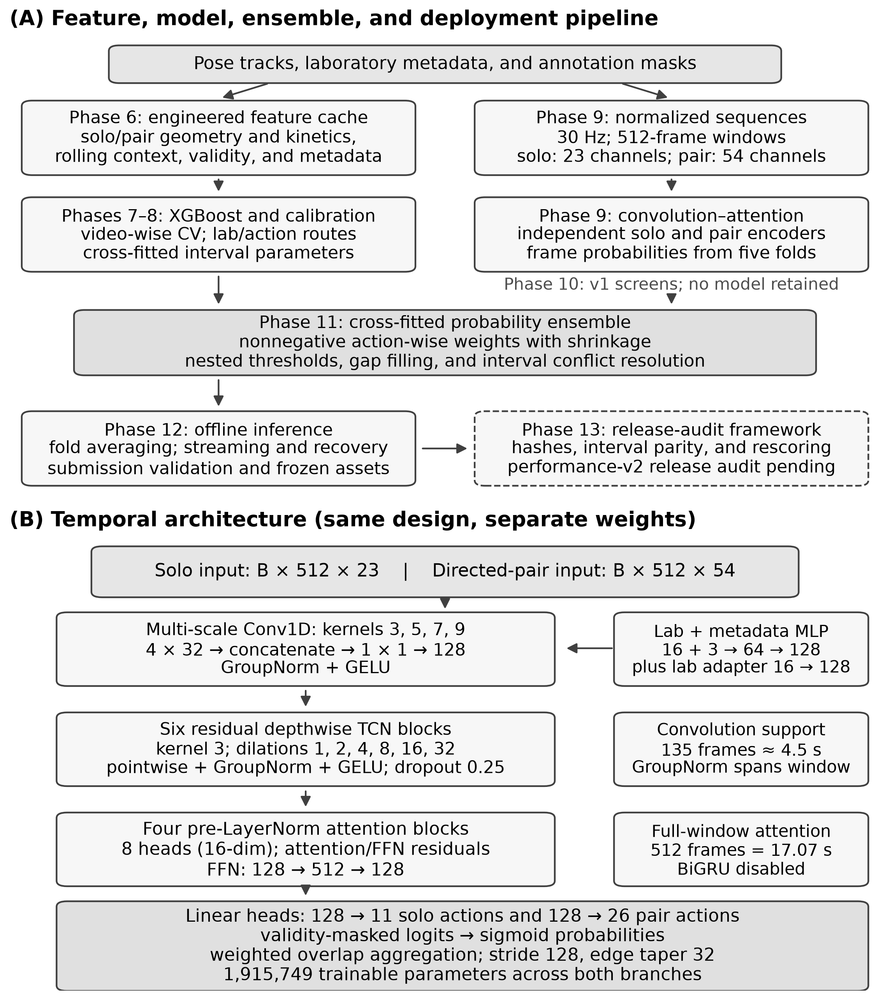
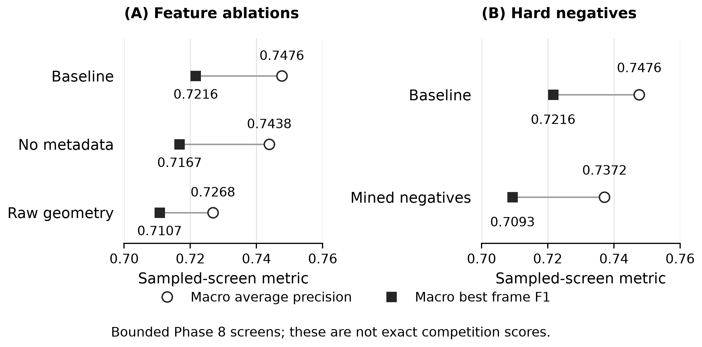
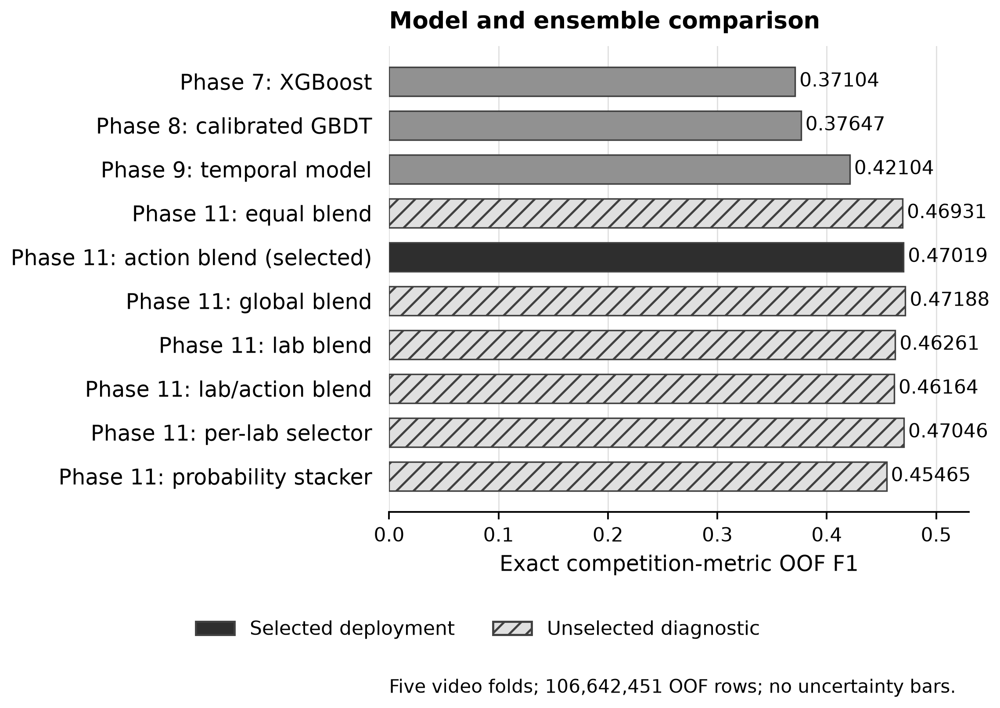

**Pose-Based Mouse Behavior Recognition with Geometric Features, Temporal Attention, and Probability Ensembling**

# 1. Methodology

We study social and nonsocial mouse behavior recognition from pose trajectories in the MABe Challenge (Sun et al. 2025). A central difficulty is that the same action must be recognized across laboratories with different tracking systems, recording conditions, and annotation protocols, a challenge also emphasized by the MABe22 benchmark (Sun et al. 2023). Our approach combines two representations of behavior: geometric and motion features for laboratory-specific gradient-boosted trees, and compact pose sequences for a convolution–attention network. We then combine their probabilities and decode them into behavior intervals. Figure 1 gives an overview of this design. The following sections describe feature construction, model development, ensembling, and deployment, corresponding to Phases 6–13 of the project.

The prediction unit is an action at a frame for a particular agent–target pair. Nonsocial, or solo, actions use the target token “self”; social actions retain the identities and ordering of two different mice. This ordering matters because exchanging the agent and target can change the meaning of an interaction. Supervision is also incomplete: each video specifies which agent–target–action combinations were annotated. We treat combinations outside that annotation mask as unknown, not as negative examples, and apply the mask consistently during training and evaluation. Although the neural model predicts actions independently, the final decoder assigns at most one action to each directed pair at a frame. An agent may still act toward several different targets, as permitted by the competition scorer.

## 1.1. Geometric and Motion Features (Phase 6)

We constructed separate feature sets for individual mice and directed mouse pairs from the cleaned pose trajectories. Feature extraction uses canonical landmarks, original frame identifiers, timestamps, and tracking-quality masks. The same extraction code is used for training and inference, with fixed column ordering and float32 storage. Missing coordinates are represented by finite defaults together with availability indicators; computed features that contain nonfinite values are rejected.

The solo representation captures posture, locomotion, and spatial context. Motion features include velocity, speed, acceleration, jerk, path length, pause ratios, and turning. Posture is described by inter-landmark distances, body length, orientation, and angular velocity. We retain calibrated distances where available, while using body-relative quantities for feature families in which translation or rotation invariance is appropriate. Position features include raw and calibrated centers, distances to the video center, and rectangular video-boundary proxies. These proxies should not be interpreted as measured arena boundaries: arena-relative coordinates use the available dimensions and an assumed origin.

For social behaviors, absolute posture alone is insufficient. The pair representation therefore describes the target relative to the agent through center distance, nose-to-nose, nose-to-body, nose-to-lateral, and nose-to-tail distances, relative velocity, acceleration and jerk, closing speed, heading agreement, facing geometry, and contact ratios. We also project relative displacement onto the agent's body axis and its perpendicular axis. These egocentric forward and lateral coordinates preserve the direction of an interaction even when the corresponding inter-mouse distance is symmetric.

When more than two mice are present, group features provide additional context: distances from the nearest third mouse to the agent, target, and pair midpoint; nearby-mouse counts; mice positioned between the pair; pair-distance rank; and group-centroid location and dispersion. Such quantities have explicit validity indicators and are zeroed in dyadic recordings. Laboratory, tracker, skeleton, frame rate, mouse count, arena properties, and available animal attributes are encoded through stable category codes and one-hot indicators, including missing and unknown categories.

Tracking reliability is represented alongside behavior geometry. Quality features distinguish observed, interpolated, invalid, and missing landmarks and describe confidence, discontinuities, and suspected identity swaps. Missingness indicators also reflect long tracking gaps. Suspected swaps are flagged rather than automatically corrected, so the feature pipeline does not silently alter mouse identities.

To capture behavior at several time scales, we summarize motion and interaction over centered radii of 0.1, 0.25, 0.5, 1, 2, and 5 s. Durations are converted to frames by half-up rounding, with a minimum radius of one frame; a 5-s radius therefore covers approximately 10 s away from a video boundary. Derivatives use timestamps and reject adjacent gaps greater than 0.2 s, while temporal summaries account for valid observations and truncated edges. This noncausal context is compatible with offline inference, where the complete recording is available. The full registries contain 244 solo and 324 pair features. Our selected tree configuration excludes the raw-coordinate family, leaving 240 solo and 321 pair features (Table 1).

**Table 1. Input representations used by the two model branches. Engineered-feature counts refer to the selected tree configuration.**

| Representation | Dimension | Principal information |
|---|---:|---|
| Engineered solo | 240 | Metric motion, invariant posture features, temporal summaries, video/arena proxies, quality, metadata |
| Engineered directed pair | 321 | Metric interaction, egocentric geometry, temporal summaries, third-mouse context, quality, metadata |
| Temporal solo | 23 | Five body-centered landmarks, validity flags, center displacement, speed, body axis, body length, confidence |
| Temporal directed pair | 54 | Two solo vectors and eight relative-geometry/validity channels |

## 1.2. Laboratory-Specific Gradient Boosting (Phase 7)

We used XGBoost as the tree baseline because it can model nonlinear relationships among the engineered features without requiring a learned pose representation (Chen and Guestrin 2016). A binary classifier is fitted for each laboratory–action combination with sufficient supervision, using either the solo or directed-pair feature matrix. The routing policy requires at least 100 sampled positive rows from two videos for a direct model. Where direct support is insufficient, it can use a pooled action model or explicitly reviewed auxiliary data if the support and annotation semantics allow; otherwise, it abstains. In the performance-v2 experiments, the five-fold registry contains 450 direct models, 60 abstaining routes, and no pooled models.

Training samples include positive frames, negatives near annotated event boundaries, and background blocks. Each laboratory–action sampling plan allows up to 50,000 positive and 150,000 total rows, with a target negative-to-positive ratio of five and at least 5,000 negatives where available. These budgets are distributed across folds before the outer-training subset is selected, rather than defining the size of every fitted classifier. We used histogram-based boosting with a maximum of 1,500 trees, learning rate 0.03, and depth six; the remaining settings appear in Table 2.

For each outer fold, an inner fold drawn from the outer-training videos determines the number of boosting rounds through early stopping. We then refit the classifier on all outer-training rows using that number of rounds. The held-out predictions are retained as probabilities, together with their frame, entity, action, mask, and fold identifiers. Keeping probabilities rather than only binary labels allows the decoder and ensemble to be fitted separately from the base classifier.

## 1.3. Decoder Optimization and Tree-Model Screening (Phase 8)

Framewise predictions must be converted into temporally coherent, mutually compatible intervals. We therefore treated probability estimation and interval decoding as separate parts of the system. Initial screens compared feature families, tree capacity, positive weighting, row budgets, and hard-negative mining. The mining experiment added confidently incorrect background rows identified from previous out-of-fold (OOF) predictions, excluding the evaluated fold from direct training membership. We also screened LightGBM and CatBoost to assess whether alternative tree families offered useful error diversity (Ke et al. 2017; Prokhorenkova et al. 2018). Sampled metrics guided these comparisons, but a change was retained in the final system only after evaluation with the complete competition scorer.

The decoder produces maximal half-open intervals [start_frame, stop_frame). Its probability-processing stage uses centered smoothing and hysteresis: a contiguous run above the lower threshold is retained if it contains at least one frame above the activation threshold. This is an offline, two-sided rule rather than an online continuation policy. Competing actions are resolved using probability divided by the relevant threshold. Interval processing then removes short runs and fills eligible short gaps, without bridging a gap occupied by another action.

Decoder parameters are fitted on OOF predictions from the four nonscored folds. Laboratory–action parameters require sufficient positive-frame and video support; otherwise, calibration falls back to action-level and global estimates. Smoothing durations specify centered radii, while gap and minimum-run settings specify interval durations. All are converted using the video's declared frame rate, and emitted endpoints remain in the original frame system. The selected tree system uses the baseline model probabilities, so its improvement over Phase 7 comes from decoding rather than from an additional tree ensemble.

## 1.4. Temporal Representation Learning (Phase 9)

The tree branch summarizes trajectories through predefined features. To complement that representation, we trained a temporal network directly on compact pose sequences. Cleaned trajectories are resampled to 30 Hz by selecting the nearest original timestamp, and frame maps are retained to return predictions to the competition frame system. Resampling may repeat or omit observations; the mapping preserves correspondence but does not invert those changes losslessly.

We selected five landmarks: nose, left ear, right ear, body center, and tail base. Cached coordinates are centered at the video's median valid mouse center and scaled by its median valid body length. The final posture channels then subtract each mouse's instantaneous center, giving ten body-centered coordinates. Together with five landmark-validity flags, two center-displacement components, displacement magnitude, two body-axis components, normalized body length, tracking confidence, and mouse validity, these form the 23-channel solo input. The velocity-like channels are per-resampled-frame differences in body-length units, not velocities in units per second.

The 54-channel directed-pair input concatenates the agent and target solo vectors with eight interaction channels: two relative-center coordinates, distance, two relative-displacement changes, heading dot and cross products, and pair validity. Missing coordinates are zeroed and retain explicit masks. This representation is smaller than the engineered tree input and lets the network learn temporal combinations of posture and relative motion.

Each example contains 512 sampled frames, equivalent to 17.07 s. Solo and pair routes use separate encoders and output heads, with the same architectural design but independent parameters. A multiscale stem applies parallel temporal convolutions with kernels of 3, 5, 7, and 9 frames, each producing 32 channels. The concatenated outputs are projected to 128 channels, followed by one-group GroupNorm and GELU.

Laboratory conditioning is added to this representation before temporal encoding. A learned 16-dimensional laboratory embedding is concatenated with source frame rate divided by 30, mouse count divided by four, and a scale-validity indicator. An MLP maps these 19 values through 64 hidden units to 128 channels and broadcasts the result over time. A separate 16-dimensional laboratory embedding is projected to the same width to provide an additive adapter.

Six residual temporal blocks follow the stem. Each applies a depthwise kernel-three convolution, pointwise channel mixing, GroupNorm, GELU, and dropout; the dilation sequence is 1, 2, 4, 8, 16, and 32. This uses dilated convolutions to capture motion over multiple temporal scales, following the sequence-modeling approach of Bai, Kolter, and Koltun (2018). Centered padding makes the encoder noncausal. The convolutional kernels alone cover 135 frames, or approximately 4.5 s, but this is not the receptive field of the complete encoder: one-group GroupNorm also uses temporal statistics from the entire window (Wu and He 2018).

Four pre-normalized self-attention blocks then relate positions throughout the 512-frame sequence (Vaswani et al. 2017). Each has eight heads, residual connections, and a feed-forward layer expanding from 128 to 512 channels before returning to 128, with dropout 0.25. No separate positional embedding is added; attention operates on the temporally ordered convolutional features. Linear heads produce 11 solo and 26 pair logits per frame. Actions outside the permitted mask receive a logit of −20 before sigmoid conversion. Validity masks constrain supervision and outputs, but attention itself has no padding mask. The selected model omits the optional bidirectional GRU and contains 1,915,749 trainable parameters.

**Figure 1.** Overview of the feature, model, and deployment pipeline for Phases 6–13. Engineered features feed the tree branch, while compact pose sequences feed independent solo and pair convolution–attention encoders. The branches are combined at the probability level before interval decoding. Phase 10 represents the earlier exploratory model study; Phase 13 represents the release framework, not a completed performance-v2 acceptance audit.

### 1.4.1. Training Objective

We train the temporal model with a project-specific combination of focal-modulated binary cross-entropy and a macro soft-F1 penalty:

$$
\mathcal{L}=\mathcal{L}_{\mathrm{focal}}+0.20\left(1-\frac{1}{|\mathcal{A}|}\sum_{a\in\mathcal{A}}F_{1,a}^{\mathrm{soft}}\right).
$$

The focal term uses positive BCE weight 1.5 and focusing exponent two to emphasize positive and difficult examples, adapting the focusing factor of [Lin et al. (2017, Section 3.2, Eq. (4))](https://arxiv.org/pdf/1708.02002v1#page=3). BCE is evaluated directly from logits for numerical stability (PyTorch 2026). Both loss components exclude unannotated actions and invalid frames or entities, and use normalized inverse-square-root training-video counts to weight laboratories.

Soft F1 replaces thresholded predictions with probabilities, providing a differentiable overlap penalty:

$$
F_{1,a}^{\mathrm{soft}}=\frac{2\mathrm{TP}_a+\epsilon}{2\mathrm{TP}_a+\mathrm{FP}_a+\mathrm{FN}_a+\epsilon}.
$$

Here, TP, FP, and FN are probability-based counts summed over batch and time using the supervision masks and laboratory weights. The action set A contains channels with valid supervision in the current solo or pair batch, including channels with no positive targets; epsilon is fixed at 1e-6. Macro averaging gives each active action one contribution.

The additive coefficient 0.20 is a configured design choice, not a value prescribed by the focal-loss paper or established as optimal by a controlled performance-v2 ablation. This loss is a training surrogate, distinct from competition F1 evaluated on decoded intervals.

### 1.4.2. Sampling, Augmentation, and Inference

We targeted a sampling mixture of 60% positive-centered windows, 35% randomly centered background windows, and 5% mined hard-negative windows. Random windows can contain positive frames, and the hard-negative allocation falls back to random windows when eligible mined examples are unavailable. Training alternates solo and pair batches and uses AdamW, warm-up followed by cosine learning-rate decay, gradient clipping, mixed precision on CUDA, and an exponential moving average of model parameters (Loshchilov and Hutter 2019).

Pose augmentation includes coordinate noise, time stretching, landmark dropout, left–right landmark exchange, mouse permutation, rotation, reflection, scaling, and temporal shifts. Entity permutations and time stretching transform the associated targets and masks. Temporal shifts instead move the pose inputs while keeping labels fixed, encouraging tolerance to small input–annotation timing offsets. Same-laboratory MixUp interpolates compatible features and labels and intersects their supervision masks; temporal CutMix replaces a contiguous interval of features, labels, and masks (Zhang et al. 2018; Yun et al. 2019).

At inference, 512-frame windows advance by 128 frames. A 32-frame linear ramp downweights interior window edges, while edges at video boundaries retain full weight. We average probabilities from each original window and its reflected, left–right-swapped counterpart, then combine overlapping windows and map the result back to original frames. This reconstructs a continuous probability sequence before interval decoding.

## 1.5. Exploratory Temporal-Model Study (Phase 10)

An earlier exploratory study defined 17 candidate configurations to examine window length, lightweight convolution–attention blocks, soft-F1 weighting, laboratory adapters, four-, five-, and seven-landmark inputs, and isolated augmentation policies. The bounded protocol first screens candidates on a fixed fold and allows at most one to advance to full five-fold evaluation; family-level stopping can skip later candidates after repeated failures. Each screen allows three epochs, 60 steps per epoch, batch size eight, and 128 validation windows per route. Advancement requires an average-precision gain of at least 0.002, followed by an exact-F1 gain of 0.005 over the temporal reference for final retention.

More expensive skeleton graph models and additional test-time augmentation were conditional on available compute and favorable screening evidence. This study predates performance-v2 and uses the earlier compact temporal configuration. We therefore report it as exploratory development rather than as a controlled ablation of the architecture described above.

## 1.6. Probability Ensembling (Phase 11)

The two branches capture different aspects of behavior, so we combine their continuous probabilities before thresholding. An alignment check matches the tree and temporal predictions by laboratory, video, original frame, agent, target, action, and fold, and verifies agreement in targets and validity masks.

For scored fold k, blend weights are estimated using the other four folds. The action-wise combination is

$$
p_a^{(k)}=(1-w_a^{(k)})p_a^{\mathrm{tree}}+w_a^{(k)}p_a^{\mathrm{temporal}},\quad 0\leq w_a^{(k)}\leq1.
$$

We compare global, action, laboratory, and laboratory–action weight scopes on the temporal-weight grid {0, 0.025, 0.05, 0.10, 0.15, 0.20, 0.30, 0.40, 0.50, 0.65, 0.80, 1}. Weight fitting uses a threshold-optimized macro frame-F1 surrogate, not the complete interval scorer. Fine-grained estimates shrink toward parent weights according to positive-frame support, with shrinkage factor support divided by support plus 5,000, and sparse groups fall back to broader estimates. Decoder parameters are subsequently fitted for each candidate using the exact competition scorer on its calibration folds.

For comparison, we evaluate equal weighting and a per-laboratory candidate selector. We also train a nonlinear XGBoost stacker on the two base probabilities, using 300 depth-three trees with learning rate 0.05 and regularization. The stacker does not receive the engineered features again; those are already represented by the tree probabilities. Deployment selection is restricted to the tree baseline, action-wise blend, and stacker, subject to score-improvement and runtime criteria. The other weight scopes and the per-laboratory selector remain diagnostic comparisons.

## 1.7. Offline Inference and Recovery (Phase 12)

Deployment uses a self-contained bundle of model registries, five temporal checkpoints, fold-specific tree models, feature schemas, vocabulary, pose settings, calibration files, and source code. We average fold predictions within each model family and average the cross-fitted action weights. In contrast, numerical decoder parameters are aggregated by their median. Test-data discovery uses metadata and tracking-file evidence, then builds manifests of laboratories, skeletons, frame rates, mice, and permitted action triplets.

Inference is organized around individual videos. Completed intervals and diagnostics are saved between videos, model intermediates are released, and accelerator caches are cleared. A resume fingerprint derived from test metadata, inference configuration, and frozen blend and decoder files guards reuse of completed outputs. Validated partial submissions are saved periodically. If only one branch succeeds for a video, its predictions can be used without the failed branch; failure of every video raises an explicit error.

We write a mask-valid emergency submission before expensive inference begins. If a completed run otherwise produces no intervals, the final fallback selects a valid one-frame prediction with the highest threshold-normalized confidence. These safeguards are intended to preserve submission availability, not to improve accuracy. Final validation checks the seven required columns, unique row identifiers, permitted mouse/action combinations, positive interval lengths, original-frame bounds, and overlap constraints.

The deployed configuration includes one laboratory-specific exception: intervals are removed for 25-Hz videos from AdaptableSnail, including after fallback handling. This policy was inherited from earlier development. Its effect on the present model has not been established by a fresh performance-v2 comparison, so it is treated as a deployment limitation rather than as a demonstrated correction.

## 1.8. Reproducibility and Release Audit (Phase 13)

The release framework records data fingerprints, fold assignments, feature versions, model and decoder registries, dependencies, licenses, notebook outputs, and experiment inventories. To check interval parity, it partitions a frozen submission by fold, reassembles the partitions, and reproduces the exact score. Probability files are inventoried and hashed separately; sampled probabilities support confidence diagnostics, while error summaries are computed from the rescored intervals. This verifies the frozen submission and associated files; it does not retrain the models or regenerate every interval from raw probabilities.

SHA-256 verification covers local release files, externally referenced essential artifacts, and the deployment bundle, with final assets distinguished from nonselected experiments. The retained configuration and some provenance fields still refer to the earlier v1 models. A documented performance-v2 audit with updated provenance is needed to establish release acceptance of the current system.

# 2. Experimental Setup

## 2.1. Data, Validation Splits, and Evaluation Metric

The data audit identifies 8,789 training metadata rows, 847 labeled videos, and 7,926 unlabeled MABe22 videos. Our primary evaluation uses 352 videos from 15 competition laboratories; the remaining 495 labeled videos come from auxiliary sources. Five fixed video folds contain 70, 73, 70, 68, and 71 primary videos. Duplicate groups are kept within a fold, and unlabeled recordings, videos without usable annotation masks, and the ambiguous missing-annotation video are excluded from supervised training. The action vocabulary contains 37 behaviors: 11 solo and 26 directed-pair actions.

The tree branch uses primary training data only, whereas the temporal branch permits eligible labeled auxiliary sources. Its sequence cache contains 847 videos and 21,153,351 resampled frames. Both branches are evaluated on the same 352 primary videos, comprising 106,642,451 masked frame–entity–action OOF probability rows. Because their training-data eligibility differs, the tree–temporal comparison measures the complete modeling pipelines rather than architecture alone.

We use the competition scorer, which expands half-open intervals into frame sets and pools true positives, false positives, and false negatives for each action within each laboratory. Action F1 values are averaged within laboratories, then laboratory scores are averaged equally. For beta equal to one, the score is

$$
S=\frac{1}{L}\sum_{\ell=1}^{L}\frac{1}{|\mathcal{A}_{\ell}|}\sum_{a\in\mathcal{A}_{\ell}}\frac{2\mathrm{TP}_{\ell a}}{2\mathrm{TP}_{\ell a}+\mathrm{FP}_{\ell a}+\mathrm{FN}_{\ell a}}.
$$

Here, L is the number of evaluated laboratories and the action set for each laboratory contains the actions present in its ground truth. Only annotated video-specific triplets are scored. We refer to this metric as exact competition F1 to distinguish full submission scoring from sampled framewise screens. It is a macro frame-based measure, not event matching or interval intersection-over-union. The challenge requires offline notebook inference within a nine-hour limit (Sun et al. 2025).

The validation procedures differ between the branches. Tree early stopping uses an inner split of the outer-training data. Temporal gradient updates exclude the evaluated fold, but checkpoint selection uses validation windows from that fold. Decoder parameters and ensemble weights exclude its labels directly, yet reuse ordinary OOF predictions from the other folds, whose base-model training may include the evaluated fold. The decoded tree, temporal, and ensemble scores should therefore be interpreted as development cross-validation estimates, not fully nested independent-test estimates. Repeated checkpoint and system selection on development data can introduce selection bias (Cawley and Talbot 2010); this limitation is carried into the interpretation of the results.

## 2.2. Training Configurations

Table 2 summarizes the selected training settings. Tree models use histogram boosting with GPU execution when available and a CPU fallback; the temporal reports record CUDA execution. The base random seed is 2025, with temporal initialization using 2025 plus the fold index. Neural checkpoint epoch indices are zero-based.

**Table 2. Training settings for the selected tree and temporal branches. Solo and pair neural encoders have independent weights.**

| Setting | Tree branch | Temporal branch |
|---|---|---|
| Maximum training length | 1,500 trees; patience 100 | 30 epochs × 1,000 alternating-route steps; patience 6 |
| Learning rate | 0.03 | 0.0003; 1,000-step warm-up, cosine decay |
| Capacity | Depth 6; min child weight 8 | Hidden width 128; 6 TCN blocks; 4 attention blocks |
| Regularization | L1 0.20; L2 5.0; split gamma 0.05 | Dropout 0.25; AdamW weight decay 0.0001 |
| Row/column sampling | 0.85 / 0.80 | Batch 16; positive/random-background/hard-negative 0.60/0.35/0.05 |
| Positive weighting | 1.0 | 1.5; focal exponent 2; soft-F1 coefficient 0.20 |
| Checkpoint criterion | Inner-fold area under precision–recall | Average of pooled solo and pooled pair validation AP |
| Additional controls | Histogram bins 256; 8 worker threads | Gradient norm 1; EMA decay 0.999; mixed precision |

The loss settings in Table 2 are supplemented by a laboratory-weight exponent of 0.5 and fixed soft-F1 epsilon of 1e-6. These describe the recorded configuration; their individual optimality has not been established.

Temporal validation samples 1,024 windows per route with equal positive-centered and random-background proportions. Average precision (AP) pools valid time–action entries within each route, then averages the solo and pair values. This checkpoint criterion reflects the validation sampler; it is neither macro action AP nor AP under the natural prevalence of an entire recording.

For pose augmentation, coordinate noise has standard deviation 0.01 in normalized units, time-stretch factors range from 0.75 to 1.25, and landmark-dropout probability is 0.10. Left–right exchange and mouse permutation each have probability 0.50. Geometric transformation and scaling each have probability 0.80. Conditional on geometric transformation, rotation is bounded by 180 degrees and reflection has probability 0.50; scale factors range from 0.80 to 1.20. Temporal shifts are applied with probability 0.50 and a maximum of eight frames. MixUp and CutMix each have probability 0.20; MixUp uses beta-distribution parameter 0.40, while CutMix replaces 10–40% of the sequence.

## 2.3. Screening, Calibration, and Model Selection

Tree screens use folds zero and one, up to two representative laboratory–action routes per laboratory, and at most 100,000 training and 25,000 validation rows per route. The resulting sample contains 29 routes and 58 route–fold comparisons per candidate. AP and best frame F1 are macro averages over these comparisons. Best frame F1 includes a validation-threshold search, so it serves as a screening statistic rather than an independent performance estimate.

Feature ablations remove metadata or replace metric geometry with raw coordinates. Hyperparameter screens compare depth four with stronger regularization, depth eight, square-root and fully automatic positive weighting, and different row budgets. Hard-negative mining is tested against the unmined baseline, although it is disabled in the selected tree configuration. LightGBM and CatBoost receive single-fold screens for route-level improvements and probability diversity; passing a screen does not by itself include a model in the final ensemble.

Full decoder fitting uses thresholds from 0.05 to 0.95, with an additional 0.975 option for the tree stage; centered smoothing radii of 0, 0.1, 0.2, or 0.4 s; hysteresis deltas of 0, 0.03, 0.05, or 0.10; and several gap-filling and minimum-run durations. Parameters are fitted with support-based fallbacks and the exact scorer on nonscored folds. A changed tree probability model requires a gain of at least 0.001 exact F1 for promotion, whereas decoder-stage retention requires 0.0005. Ensemble retention also requires 0.0005 over its tree reference together with a runtime criterion. Choosing the final system from these development scores is another source of selection uncertainty.

The earlier temporal-model study is available through project documentation, but its original model cards and OOF run directory are absent. We therefore discuss its outcome qualitatively rather than mixing historical results into the performance-v2 tables.

## 2.4. Computational Resources and Evidence

For deployment planning, we assumed 200 hidden videos and an internal six-hour budget with a 20% reserve, giving an acceptance ceiling of 17,280 s. This is stricter than the challenge's nine-hour limit. Ensemble-stage projections use configured per-video estimates; the final inference projection instead multiplies the measured public-video runtime by 200.

Process memory is recorded with psutil. The temporal training measurement uses peak working set where available, otherwise resident memory, and does not measure GPU allocations. Inference records resident memory after each video, rather than continuously instrumenting the peak. Although the saved reports identify CUDA execution, they do not identify the exact accelerator model for these runs, limiting the reproducibility of absolute timing comparisons.

All numerical results are drawn from the versioned tree CV report, decoder study report, temporal report and fold cards, ensemble candidate and selection registries, and inference report. The figures are generated directly from these records. The performance-v2 results are kept separate from older v1 experiments and from external competition solutions.

# 3. Experimental Results and Discussion

## 3.1. Feature and Tree-System Ablations

The tree baseline achieved exact competition F1 of 0.371042. Decoder optimization increased this to 0.376471, an absolute gain of 0.005428, without changing the feature configuration, tree hyperparameters, or model probabilities. Probability processing alone reached 0.373444; interval processing provided the remaining gain. Every fold selected a 0.2-s additional smoothing radius and hysteresis delta 0.03. The number of intervals fell from 110,506 to 57,734, a reduction of 47.75%. Together, these results show that decoding contributes to performance beyond the framewise classifier, although the smaller interval count does not establish more accurate event boundaries.

Table 3 and Figure 2 summarize the sampled screens that informed the tree configuration.

**Table 3. Sampled tree-stage comparisons. AP and best frame F1 are macro route–fold screen metrics, distinct from exact competition F1.**

| Study | Candidate | Macro AP | Best frame F1 |
|---|---|---:|---:|
| Features | Baseline families | 0.747638 | 0.721625 |
| Features | Without metadata | 0.743838 | 0.716733 |
| Features | Raw in place of metric geometry | 0.726809 | 0.710686 |
| Hard negatives | Without mined negatives | 0.747638 | 0.721625 |
| Hard negatives | With mined negatives | 0.737155 | 0.709349 |
| Hyperparameters | Square-root positive weight | 0.746798 | 0.725980 |
| Hyperparameters | Fully automatic positive weight | 0.745614 | 0.725083 |
| Hyperparameters | Depth 4, stronger regularization | 0.745824 | 0.720080 |
| Hyperparameters | Depth 8 | 0.745660 | 0.722844 |

**Figure 2.** Feature-family and hard-negative comparisons from the sampled tree screens. Points denote aggregate AP and best frame F1; the baseline is repeated within each panel as the relevant reference. Uncertainty intervals are unavailable for these descriptive comparisons.

Metric geometry was more useful than substituting raw coordinates in this screen: the replacement reduced AP by 0.020829, compared with a 0.003800 reduction when metadata was removed. This pattern is consistent with the value of common physical units across recording systems. However, the comparison changes a feature family rather than isolating a single normalization operation, so it cannot attribute the gain to an individual feature.

Hard-negative mining also failed to improve the sampled results. AP decreased by 0.010483 and best frame F1 by 0.012275. One possible explanation is that concentrating on confident false positives changed the training distribution unfavorably, but the aggregate screen does not test that explanation directly. We retained the unmined tree configuration.

Positive weighting illustrates why a thresholded screen alone was insufficient for selection. Square-root weighting raised best frame F1 from 0.721625 to 0.725980 while reducing AP. The screening procedure retained the baseline configuration, so these weighting variants were not advanced to a full five-fold probability-model evaluation. The disagreement between the screen metrics underscores the need to assess any promising change as a complete probability-and-decoding system under the competition objective.

Alternative tree families offered little additional diversity in the sampled comparisons. XGBoost, LightGBM, and CatBoost achieved macro AP of 0.740373, 0.736333, and 0.736157, respectively. LightGBM and CatBoost probabilities correlated with XGBoost at 0.9605 and 0.9513. Three LightGBM routes and five CatBoost routes met screen retention conditions, but neither family entered the final probability stream. Their small sampled gains and highly correlated outputs provided limited evidence for adding another deployment component.

## 3.2. Temporal Modeling and Complementary Errors

The temporal branch achieved exact competition F1 of 0.421040, exceeding the decoded tree reference by 0.044569. This supports the temporal pipeline as a useful complementary predictor, but does not isolate the effect of attention: the branches differ in representation, auxiliary-data eligibility, and training procedure. The checkpoint-selection limitation in Section 2.1 also applies to this score.

The fold-zero feasibility run selected epoch index 24, with validation AP 0.523576, loss 0.219740, and training time 1,960.03 s. Across folds, selected epoch indices ranged from 19 to 27. The feasibility run recorded process peak working set of 4,074.75 MB. The complete temporal pipeline took 10,789.27 s, including 711.78 s for its recorded temporal inference stage; end-to-end deployment timing is reported separately in Section 3.4.

The branches' predictions were not interchangeable. On 417,500 aligned OOF rows sampled at up to 500 evenly spaced rows per probability part, tree–temporal probability correlation was 0.618939 and error-set Jaccard overlap was 0.251207. With errors defined at threshold 0.5, neural-only and tree-only error rates were 0.018036 and 0.032862, respectively. The temporal model performed better in 63 of 93 laboratory–action comparisons, the tree model in 27, and three were tied. These descriptive diagnostics motivated probability blending; they do not establish statistical independence between errors.

The earlier exploratory study reported that only the 256-frame candidate passed screening, and that its subsequent full-fold score was below the compact temporal reference. No candidate was retained. That study used an earlier CPU development configuration, and its original artifacts are unavailable. Its negative outcome therefore should not be generalized to shorter windows, larger landmark sets, or graph models in performance-v2. Those questions require controlled comparisons using the current training data and evaluation protocol.

## 3.3. Ensemble and Decoder Comparisons

Alignment succeeded across 835 probability parts and 106,642,451 rows, with no duplicate keys, missing routes, target/mask disagreements, or alignment failures. Table 4 and Figure 3 compare the resulting development scores. The selected action-wise blend reached 0.470192, gaining 0.093721 over the decoded tree reference and 0.049152 over the standalone temporal model. Relative to the tree score, this is a 24.90% increase in F1, not a corresponding reduction in classification error.

**Table 4. Exact competition F1 on the fixed primary development folds. Delta is measured from the Phase 8 tree reference. Scores follow the development protocol and validation limitations in Section 2.1.**

| Candidate | Exact F1 | Delta vs. Phase 8 | Status |
|---|---:|---:|---|
| Phase 7 tree baseline | 0.371042 | −0.005428 | Initial reference |
| Phase 8 calibrated tree | 0.376471 | 0.000000 | Ensemble reference |
| Phase 9 temporal | 0.421040 | +0.044569 | Base stream |
| Equal tree–temporal blend | 0.469314 | +0.092844 | Comparison |
| Action-wise blend | **0.470192** | **+0.093721** | Selected deployment |
| Global blend | 0.471882 | +0.095411 | Diagnostic |
| Laboratory-wise blend | 0.462610 | +0.086139 | Diagnostic |
| Laboratory–action blend | 0.461637 | +0.085166 | Diagnostic |
| Per-laboratory selector | 0.470459 | +0.093988 | Diagnostic |
| Nonlinear stacker | 0.454654 | +0.078183 | Not promoted |

**Figure 3.** Development F1 for individual branches and ensemble candidates. The highlighted action-wise blend is the deployed model. The higher-scoring global blend and per-laboratory selector were outside the deployment candidate set. These are development scores, not independent-test results; repeated-seed or independent-test uncertainty estimates are unavailable.

Most of the ensemble gain was already obtained with equal weighting, which scored 0.469314. Action-specific fitting added 0.000877. This small increment, compared with the much larger gain over either branch alone, suggests that combining their complementary predictions was more important than finely tuning the weights.

The action-wise blend was not the highest-scoring diagnostic system. The global blend exceeded it by 0.001690, and the per-laboratory selector by 0.000267. They were excluded by the implementation's deployment candidate restriction, not by an observed failure of the runtime gate. The restriction was not documented as preregistered, so selection of the action blend should be understood within that candidate set rather than as optimization over every evaluated strategy.

Laboratory-specific and laboratory–action-specific weighting performed worse than action-wise weighting. Smaller calibration groups may have yielded less reliable estimates, although the aggregate results cannot separate that effect from differences in fitted decoders. The nonlinear stacker scored 0.454654, below both simple blends. Extra capacity at the probability-combination stage did not translate into a better complete-system score in these experiments.

The selected registry contains 170 fold–action weight records, with shrunk temporal weights ranging from 0.132958 to 0.978751 and median 0.65. Its 510 decoder records use thresholds from 0.10 to 0.75, with median 0.50, a 0.1-s baseline smoothing radius, and no additional smoothing or hysteresis. Gap-filling durations are 0.2667 or 0.5 s, and minimum-run durations are zero or 0.0667 s. The resulting submission contains 54,305 intervals. Because each ensemble candidate has its own fitted decoder, Table 4 compares complete systems rather than probability blends under a fixed decoding policy.

## 3.4. Runtime and Submission Reliability

The deployment benchmark processed one public-test AdaptableSnail video with 18,423 original frames and four mice in 45.1345 s. It produced 339 intervals with no failed videos, degraded routes, submission-validation errors, or final one-frame fallback. Table 5 reports the stage timings and resource measurements. These results establish successful local execution and schema validation; the public video provides no hidden-test accuracy measurement.

**Table 5. Single-video inference measurements and linear projection to 200 videos. Resident memory was sampled after video processing, not continuously at its peak.**

| Quantity | Recorded value |
|---|---:|
| GBDT stage | 12.1608 s |
| Temporal stage | 31.2887 s |
| Blending and decoding | 1.3483 s |
| Total including other overhead | 45.1345 s |
| Observed process resident memory | 2,800.63 MB |
| Output intervals | 339 |
| Failed/degraded videos | 0 / 0 |
| Validation errors / fallback use | 0 / No |
| Projected total for 200 videos | 9,026.91 s (2.51 h) |

The projected runtime leaves 58.21% headroom under the internal six-hour budget, exceeding the required 20% reserve. The temporal branch accounts for most measured computation. However, a single video cannot represent the full distribution of recording lengths, mouse counts, and permitted interaction pairs. Longer videos or more pair routes may increase cost, so the projection supports local feasibility rather than guaranteeing hidden-test completion. Checkpointing and partial submissions reduce the consequences of interruption without resolving this measurement limitation.

The 25-Hz AdaptableSnail exception is also unresolved. Affected videos intentionally receive no intervals, and the successful public-video run does not establish the benefit of that policy. Comparison with unmodified inference and frame scaling under an independent selection protocol is needed before attributing an accuracy gain to it.

## 3.5. Interpretation and Limitations

The main finding is that feature-based and sequence-based predictors work well together in the recorded development experiments. Metric geometry outperformed its raw-coordinate replacement in the sampled tree screen, and decoder optimization improved F1 while leaving tree probabilities unchanged. Combining the tree and temporal branches produced the largest gain, consistent with their moderate probability correlation and limited error overlap. The experiments support these pipeline-level observations, but do not identify a single indispensable neural component.

The evaluation leaves several questions open. Holding out videos from represented laboratories does not measure transfer to an entirely unseen laboratory, skeleton, or tracking system. Differences in auxiliary-data eligibility confound architecture comparisons. Temporal checkpoint selection and ordinary OOF reuse do not provide fully nested evaluation, and final system selection also uses the development folds. Only one base seed is represented, with no confidence intervals or paired significance tests. These limitations prevent a precise assessment of generalization uncertainty or the reliability of small differences between ensemble strategies.

Reproducibility records also require attention. The saved temporal manifest marks early stopping as independent of held-out labels, whereas the training loop uses validation windows from the evaluated fold. Our interpretation follows the implementation. In addition, release configuration and provenance still refer to v1, and performance-v2 acceptance remains unverified. Hashing verifies file integrity, not the independence of model selection; the release audit should therefore check the validation protocol as well as updating artifact references.

No retained performance-v2 record supplies a Kaggle public/private score, team rank, or leaderboard screenshot, so the development F1 values are not presented as leaderboard results. A more rigorous evaluation would combine an independent test set or fully nested selection protocol, controlled neural and auxiliary-data ablations, multiple seeds, and a runtime benchmark covering diverse recordings. Within the available evidence, the results show the practical value of combining geometric features, temporal representations, and interval decoding, while making clear which claims still require further evaluation.

## References

Bai, S.; Kolter, J. Z.; and Koltun, V. 2018. An Empirical Evaluation of Generic Convolutional and Recurrent Networks for Sequence Modeling. arXiv:1803.01271. [Paper](https://arxiv.org/abs/1803.01271).

Cawley, G. C.; and Talbot, N. L. C. 2010. On Over-fitting in Model Selection and Subsequent Selection Bias in Performance Evaluation. *Journal of Machine Learning Research*, 11(70): 2079–2107. [Paper](https://www.jmlr.org/papers/v11/cawley10a.html).

Chen, T.; and Guestrin, C. 2016. XGBoost: A Scalable Tree Boosting System. In *Proceedings of the 22nd ACM SIGKDD International Conference on Knowledge Discovery and Data Mining*, 785–794. New York: Association for Computing Machinery. doi:10.1145/2939672.2939785. [Paper](https://arxiv.org/abs/1603.02754).

Ke, G.; Meng, Q.; Finley, T.; Wang, T.; Chen, W.; Ma, W.; Ye, Q.; and Liu, T.-Y. 2017. LightGBM: A Highly Efficient Gradient Boosting Decision Tree. In *Advances in Neural Information Processing Systems 30*, 3146–3154. [Paper](https://papers.nips.cc/paper/2017/hash/6449f44a102fde848669bdd9eb6b76fa-Abstract.html).

Lin, T.-Y.; Goyal, P.; Girshick, R.; He, K.; and Dollár, P. 2017. Focal Loss for Dense Object Detection. In *Proceedings of the IEEE International Conference on Computer Vision*, 2980–2988. doi:10.1109/ICCV.2017.324. [Paper](https://arxiv.org/abs/1708.02002). [Original 2017 preprint, p. 3: Eqs. (2)–(5)](https://arxiv.org/pdf/1708.02002v1#page=3).

Loshchilov, I.; and Hutter, F. 2019. Decoupled Weight Decay Regularization. In *Proceedings of the International Conference on Learning Representations*. [Paper](https://arxiv.org/abs/1711.05101).

Prokhorenkova, L.; Gusev, G.; Vorobev, A.; Dorogush, A. V.; and Gulin, A. 2018. CatBoost: Unbiased Boosting with Categorical Features. In *Advances in Neural Information Processing Systems 31*, 6638–6648. [Paper](https://papers.nips.cc/paper/2018/hash/14491b756b3a51daac41c24863285549-Abstract.html).

PyTorch. 2026. BCEWithLogitsLoss. PyTorch 2.14 Documentation. [Documentation](https://docs.pytorch.org/docs/2.14/generated/torch.nn.BCEWithLogitsLoss.html). Accessed October 14, 2026.

Sun, J. J.; Marks, M.; Ulmer, A. W.; Chakraborty, D.; Geuther, B.; Hayes, E.; Jia, H.; Kumar, V.; Oleszko, S.; Partridge, Z.; Peelman, M.; Robie, A.; Schretter, C. E.; Sheppard, K.; Sun, C.; Uttarwar, P.; Wagner, J. M.; Werner, E.; Parker, J.; Perona, P.; Yue, Y.; Branson, K.; and Kennedy, A. 2023. MABe22: A Multi-Species Multi-Task Benchmark for Learned Representations of Behavior. In *Proceedings of the 40th International Conference on Machine Learning*, 32936–32990. Proceedings of Machine Learning Research 202. [Paper](https://proceedings.mlr.press/v202/sun23g.html).

Sun, J. J.; Marks, M.; Golden, S.; Pereira, T.; Kennedy, A.; Dane, S.; Howard, A.; and Chow, A. 2025. MABe Challenge—Social Action Recognition in Mice. Kaggle. [Competition](https://www.kaggle.com/competitions/MABe-mouse-behavior-detection/overview). Accessed October 4, 2026.

Vaswani, A.; Shazeer, N.; Parmar, N.; Uszkoreit, J.; Jones, L.; Gomez, A. N.; Kaiser, Ł.; and Polosukhin, I. 2017. Attention Is All You Need. In *Advances in Neural Information Processing Systems 30*, 5998–6008. [Paper](https://papers.nips.cc/paper/2017/hash/3f5ee243547dee91fbd053c1c4a845aa-Abstract.html).

Wu, Y.; and He, K. 2018. Group Normalization. In *Proceedings of the European Conference on Computer Vision*, 3–19. [Paper](https://arxiv.org/abs/1803.08494).

Yun, S.; Han, D.; Oh, S. J.; Chun, S.; Choe, J.; and Yoo, Y. 2019. CutMix: Regularization Strategy to Train Strong Classifiers with Localizable Features. In *Proceedings of the IEEE/CVF International Conference on Computer Vision*, 6023–6032. [Paper](https://arxiv.org/abs/1905.04899).

Zhang, H.; Cisse, M.; Dauphin, Y. N.; and Lopez-Paz, D. 2018. mixup: Beyond Empirical Risk Minimization. In *Proceedings of the International Conference on Learning Representations*. [Paper](https://arxiv.org/abs/1710.09412).
