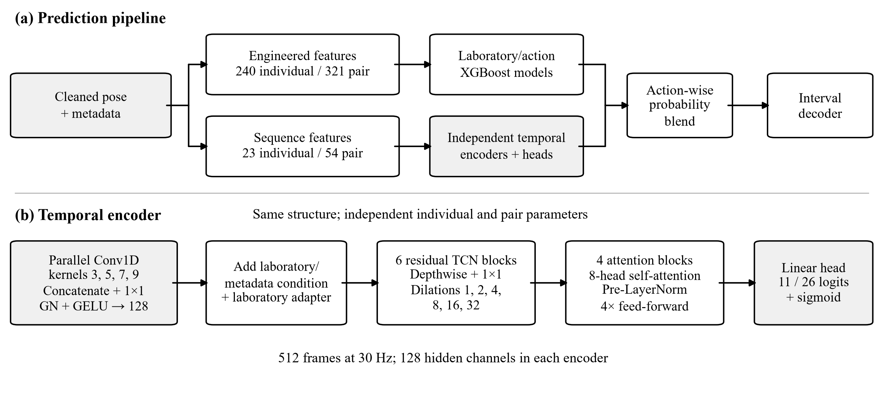
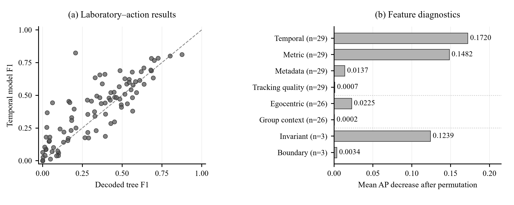

# Combining Gradient-Boosted Trees and Temporal Attention for Pose-Based Mouse Behaviour Recognition

Chew Yee Chen1,*, Jovan Tan Chun Ee1,*, Law Zhi Xuan1,*, Xu Zixuan1,*

1 College of Computing and Data Science, Nanyang Technological University

* These authors contributed equally to this work.

## Abstract

Recognising mouse behaviour from pose trajectories requires models to distinguish similar movements despite incomplete annotations and differences in recording conditions. We investigate whether engineered geometric and motion features complement learned temporal representations in the MABe Challenge. Our system combines laboratory- and action-specific gradient-boosted trees with a convolution–attention model that uses separate encoders for individual and directed pairwise behaviours. Annotation masks restrict training to supported labels, and an action-wise convex blend combines the two sets of framewise probabilities before interval decoding. We evaluate the system using five video-grouped folds covering 352 primary videos from 15 laboratories. On the competition-defined F1 metric, the tree and temporal pipelines obtain development scores of 0.3765 and 0.4210, respectively; the selected ensemble reaches 0.4702. Temporal checkpoints are selected using the evaluated fold, and downstream model selection is not fully nested, so these scores are development estimates rather than independent-test estimates. Within this evaluation, combining the two representations improves on either constituent pipeline, supporting their use as complementary predictors for heterogeneous pose-based behaviour recognition.

## 1 Introduction

Quantifying animal behaviour is central to understanding how neural activity relates to action. Video recording makes extended observation practical, but turning those recordings into consistent behavioural annotations remains demanding. Computational neuroethology addresses this gap by connecting measurements of movement with descriptions of behaviour (Datta et al. 2019). Pose trajectories provide a compact representation of an animal's movements, yet the mapping from movement to behaviour is rarely determined by a single frame. Similar poses can occur in different actions, while social behaviours depend on how one animal moves relative to another over time.

Established approaches offer two useful perspectives on this problem. JAABA learns behaviour classifiers from examples annotated by a user, demonstrating the value of combining expert labels with features derived from tracked movement (Kabra et al. 2013). SimBA uses pose-derived geometric and motion features with supervised random forests, providing a practical framework for interpretable behaviour classification (Goodwin et al. 2024). Representation learning offers a complementary direction: MABe22 benchmarks learned video and trajectory representations across multiple species and behavioural tasks (Sun et al. 2023). These studies motivate a question for the present work: can a learned temporal representation add useful information to a strong classifier built on engineered pose features?

We examine this question in the MABe Challenge on social action recognition in mice (Sun et al. 2025). The task is to infer labelled action intervals from two-dimensional pose trajectories and recording metadata. Some actions describe an individual mouse; others describe an interaction with a directed actor–target relationship. The supervision is also incomplete: an unannotated actor–target–action combination cannot automatically be treated as a negative example. Differences in frame rate, tracked landmarks, physical scale, and annotation coverage further complicate learning across recordings. A useful system must therefore account for both the temporal structure of behaviour and the conditions under which labels are available.

Our approach combines two predictors with different representations of the same trajectories. The first uses laboratory- and action-specific XGBoost classifiers (Chen and Guestrin 2016) trained on engineered features describing posture, motion, and inter-animal geometry. The second learns temporal features through convolutional and attention blocks, with independent encoders for individual and pairwise actions. Supervision masks exclude unsupported labels from the training objectives. At inference, an action-wise convex blend combines the predictors' probabilities, and an interval decoder applies thresholds, temporal processing, and conflict resolution to produce the required action segments. The rationale is that explicit geometry and learned temporal context may capture different evidence, even when they originate from the same pose tracks.

Our experiments provide evidence that the two predictors capture complementary information. Across five video-grouped development folds, the decoded tree pipeline scores 0.3765 and the temporal pipeline scores 0.4210 on the competition-defined F1 metric; the selected ensemble scores 0.4702. These are complete-pipeline comparisons: the temporal branch admits auxiliary supervised data excluded from tree training, and decoding parameters are fitted for each system. Temporal checkpoint selection uses the evaluated fold, and downstream selection is not fully nested, so the scores are development estimates. The study concerns videos from represented laboratories; transfer to entirely unseen laboratories remains untested.

## 2 Problem Formulation, Data, and Evaluation

### 2.1 Task and Supervised Data

Given a video's two-dimensional landmark trajectories and recording metadata, the task is to identify which mouse performs each action, its target, and its temporal extent (Sun et al. 2025). We denote a framewise action probability by $p_{v,i,j,a}(t)$, where $v$ identifies the video, $i$ the actor, $j$ the target, and $a$ the action. Individual behaviours use the actor itself as the target, represented canonically as `self` in supervision masks; social behaviours use a distinct target mouse. Actor–target order is meaningful. Predictions are exported as tuples $(v,i,j,a,s,e)$ with half-open intervals $[s,e)$ in the original video's frame coordinates.

Supervision is defined by each video's permitted actor–target–action triplets. For a permitted triplet, frames covered by a retained annotation interval are positive and uncovered frames are valid negatives. Triplets absent from this list are unknown and contribute no supervised loss. This distinction prevents missing annotations from being interpreted as behavioural absence. Before constructing targets, we standardised identifiers and removed invalid annotation intervals; the audit identified 59 such intervals. Training also excludes triplets involving untracked mice, and temporal training masks padded timesteps.

The training release contains 8,789 videos, of which 847 have usable annotations. Table 1 reconciles the release with the subsets used in this study. The primary evaluation comprises 352 videos from 15 laboratories. The full canonical vocabulary contains 37 actions—11 individual and 26 pairwise—but only 34 occur in the primary subset's supervision masks. The remaining 495 labelled videos are auxiliary: they enter the temporal training pool for every primary-fold run, whereas tree training uses only primary videos. Consequently, comparisons between the two branches concern complete pipelines with different training-data eligibility.

**Table 1.** Audited training-video categories and their use. The first two rows constitute the 847 labelled videos. The reported pipeline uses supervised training only.

| Video category | Videos | Use in this study |
|---|---:|---|
| Labelled primary videos | 352 | Training and fivefold development evaluation |
| Labelled auxiliary videos | 495 | Temporal training only |
| Unlabelled MABe22 videos | 7,926 | Excluded |
| Videos without supervision masks | 15 | Excluded |
| Ambiguous annotation status | 1 | Quarantined |
| **Total** | **8,789** | Audited training release |

### 2.2 Evaluation Metric

We used the supplied competition scorer with $\beta=1$, yielding a frame-set F1 score (Sun et al. 2025). For each laboratory $\ell$ and action $a$, true positives, false positives, and false negatives are pooled over unique frame identities $(v,i,j,t)$ across videos and actor–target pairs. Predictions outside a video's permitted triplets are ignored. The overall score is

$$
S=\frac{1}{|\mathcal{L}|}\sum_{\ell\in\mathcal{L}}\frac{1}{|\mathcal{A}_{\ell}|}\sum_{a\in\mathcal{A}_{\ell}}\frac{2\mathrm{TP}_{\ell a}}{2\mathrm{TP}_{\ell a}+\mathrm{FP}_{\ell a}+\mathrm{FN}_{\ell a}},
$$

where $\mathcal{L}$ is the set of evaluated laboratories. In the supplied implementation, $\mathcal{A}_{\ell}$ includes actions present in the ground truth or in admissible predictions; a predicted-only action therefore contributes zero. A zero denominator is also assigned zero. Actions receive equal weight within each laboratory, followed by equal weighting of laboratories. This differs from averaging video scores or assigning equal weight to every action globally. Interval boundaries affect the score through the frames they include, rather than through an event-level overlap threshold.

The scorer permits simultaneous predictions for different targets but rejects competing actions for the same directed pair at the same frame. Our decoder resolves these conflicts and forms contiguous intervals before scoring. Separately, the project submission validator checks the output schema, strictly positive interval lengths, tracking bounds, and permitted triplets. These are output-validity checks, not additional terms in F1.

### 2.3 Validation and Model Selection

We used five fixed folds grouped by video and detected duplicate trajectories. Fold assignment balanced laboratory membership and laboratory–action positive duration, subject to action-support constraints. Detected duplicates were assigned together, and the saved audit records no duplicate groups crossing folds. Every primary laboratory occurs in every fold, so the protocol assesses new videos from represented laboratories. Auxiliary videos remain training-only and never contribute to the primary score.

For each evaluated fold, both branches excluded its videos from training updates. XGBoost selected the number of trees using an inner fold drawn from the other four folds, then refitted on all outer-training data. The temporal model instead used validation windows from the evaluated fold to select its checkpoint by average precision. Its evaluated-fold labels therefore influenced checkpoint selection despite being excluded from gradient updates.

Decoder parameters and ensemble weights for an evaluated fold were fitted using labels and out-of-fold probabilities from the other folds. This excludes direct use of the evaluated fold's labels at those fitting stages. However, the models producing those other-fold probabilities could themselves have trained on the evaluated fold; their predictions were not regenerated within a separate outer evaluation. Together with temporal checkpoint selection, this prevents a fully nested assessment of the complete pipeline. Such model-selection dependencies create the potential for selection bias (Cawley and Talbot 2010). We therefore report local scores as development estimates, without treating them as independent-test measurements or evidence of transfer to unseen laboratories.

## 3 Methodology

The system combines explicit descriptions of posture and motion with features learned from pose sequences (Figure 1). Both branches preserve the distinction between individual and directed pairwise actions and use the supervision rules defined in Section 2. Their framewise probabilities are aligned before blending, allowing the interval decoder to operate on the combined evidence. This separation also permits each branch and the complete ensemble to be evaluated with the same competition metric.

**Figure 1.** Implemented prediction system. (a) Engineered features and compact pose sequences feed the tree and temporal branches, respectively; action-wise probability blending precedes interval decoding. (b) The temporal encoder structure is instantiated separately for individual and pairwise inputs, with independent parameters and output heads. GN denotes group normalisation; TCN denotes temporal convolutional network. The 11/26 output channels cover the full canonical vocabulary and remain subject to video-specific supervision masks.

### 3.1 Pose Preprocessing

We aligned trajectories to ten canonical landmarks while preserving landmark availability and tracking-quality indicators. Cleanup flags large consecutive displacements using a threshold of 250 cm/s when the supplied physical scale is credible, with a fallback of 100 pixels per frame otherwise. These thresholds are tracking-quality heuristics. Only isolated spikes are removed; other detected jumps remain available as quality indicators. Short gaps of at most 0.2 s are linearly interpolated, and body centre can be derived from available head–tail geometry. Remaining unavailable coordinates are zero-filled with explicit masks.

The two branches use different coordinate representations. Tree features are calculated on the original frame grid, using centimetres when scale metadata passes consistency checks. Centimetre-dependent features are zeroed when scale is invalid, with validity indicators retained. For the temporal branch, nearest-original-frame sampling constructs a 30-Hz sequence while retaining the original-frame mapping. Cached positions subtract the video's median valid centre and are divided by its median valid body length. Subsequent input construction centres posture on each mouse at each frame, separating body configuration from translational movement.

### 3.2 Engineered Features and Tree Predictor

We constructed separate representations for individual mice and ordered pairs, containing 240 and 321 input features, respectively. Individual features describe posture, physical motion, temporal activity, tracking quality, metadata, and position relative to the video centre or boundaries. These recording-relative quantities are proxies rather than measured arena boundaries. Pair features add inter-animal distances, relative movement, actor-centred geometry, and third-mouse context. Expressing target position relative to the actor's heading preserves directionality: reversing the actor and target changes the representation.

Temporal statistics use centred radii of 0.1, 0.25, 0.5, 1, 2, and 5 s. Thus, the largest radius spans approximately 10 s away from recording boundaries. Summaries are truncated at those boundaries and accompanied by support indicators. Feature extraction is deterministic and label-independent; chunked computation retains neighbouring frames needed for these statistics.

Binary XGBoost classifiers (Chen and Guestrin 2016) map these features to probabilities for each laboratory–action combination. We fit a direct classifier when sampled training support includes at least 100 positive rows from two videos. Insufficient-support routes emit zero probabilities on the permitted candidate frames. Training draws capped positive samples, prioritises valid negatives near annotation boundaries, and supplements them with background blocks. Sampling targets five negatives per positive, subject to availability and row caps. Trees optimise binary logistic loss, with the inner early-stopping and refitting procedure described in Section 2.3. The reported tree branch uses direct laboratory-specific models; no pooled classifier is included.

### 3.3 Temporal Convolution–Attention Model

The temporal branch uses independent encoders for individual mice and ordered pairs. Each receives 512 frames at 30 Hz, corresponding to approximately 17.1 s. Individual inputs contain 23 channels derived from five landmarks: nose, both ears, body centre, and tail base. These channels comprise body-centred coordinates, landmark availability, centre displacement, body-axis geometry, body length, confidence, and entity validity. Pair inputs concatenate both individual representations with eight channels describing relative position, distance, relative displacement, heading relationships, and pair validity, giving 54 channels. Displacement channels encode adjacent-frame changes rather than physical velocity in units per second.

Each encoder begins with four parallel one-dimensional convolutions of kernel sizes 3, 5, 7, and 9, each producing 32 channels. Their concatenation is projected to 128 channels by a pointwise convolution, followed by single-group normalisation (Wu and He 2018) and GELU. Laboratory conditioning is added at every timestep: a 16-dimensional laboratory embedding is concatenated with source frame rate divided by 30, mouse count divided by four, and a scale-validity flag, then projected through a 64-hidden-unit multilayer perceptron to 128 channels. A separate 16-dimensional laboratory adapter supplies an additional learned offset.

Six residual temporal convolution blocks follow, using kernel size three and dilations 1, 2, 4, 8, 16, and 32. Each block combines depthwise and pointwise convolutions with group normalisation, GELU, and dropout. Four subsequent attention blocks use eight-head self-attention (Vaswani et al. 2017), pre-layer normalisation, residual connections, and a feed-forward expansion of four. Attention operates across the window. Framewise linear heads produce 11 individual-action or 26 pairwise-action logits, followed by sigmoid conversion to probabilities. The complete model contains 1,915,749 parameters. Padded timesteps are excluded from the loss, although attention does not receive an explicit padding mask.

### 3.4 Temporal Training Objective and Augmentation

We train the temporal model with a focal-modulated binary cross-entropy term and an auxiliary macro soft-F1 penalty:

$$
\mathcal{L}=\mathcal{L}_{\mathrm{focal}}+
0.20\left(1-\frac{1}{|\mathcal{A}|}
\sum_{a\in\mathcal{A}}F_{1,a}^{\mathrm{soft}}\right),
$$

$$
F_{1,a}^{\mathrm{soft}}=
\frac{2\widetilde{\mathrm{TP}}_a+\epsilon}
{2\widetilde{\mathrm{TP}}_a+\widetilde{\mathrm{FP}}_a+
\widetilde{\mathrm{FN}}_a+\epsilon}.
$$

For probability $p$ and target $y$, the focal term multiplies positive-weighted BCE by $(1-p_\star)^2$, where $p_\star=py+(1-p)(1-y)$, and uses a positive BCE weight of 1.5. This adapts the focusing factor of Lin et al. (2017); its positive-only weighting differs from their alpha-balanced convention. Fractional MixUp targets use the same expression for $p_\star$. Both loss components use supervision masks and normalised inverse-square-root training-video counts per laboratory. Writing their product as $w$, soft counts sum $wpy$, $wp(1-y)$, and $w(1-p)y$ over batch and time; the positive BCE weight is not applied to these counts. The active set $\mathcal{A}$ includes actions with any valid supervision, including negative-only channels, and $\epsilon=10^{-6}$. Focal-BCE is normalised by the sum of effective weights, clamped to at least one. The coefficient 0.20 is fixed in the reported configuration. This minibatch objective is a training surrogate, distinct from the decoded competition F1.

Training alternates individual and pairwise batches. Window sampling combines positive-centred, random-centred, and available prior-prediction hard-negative examples; random windows may also contain positives. Pose augmentation includes coordinate noise, landmark dropout, left–right exchange, consistent geometric transformations across mice, mouse permutation, and time stretching. Entity permutations and time stretching transform the associated targets and masks. Small temporal shifts instead move pose inputs while keeping annotation timing fixed. Same-laboratory MixUp interpolates features and targets and intersects supervision masks (Zhang et al. 2018). Our temporal adaptation of CutMix replaces a contiguous span of features, targets, and masks using a same-laboratory partner (Yun et al. 2019). These adaptations preserve the available supervision when combining examples.

### 3.5 Probability Ensembling

We align the two branches by video, original frame, actor, target, and action, then combine their probabilities before decoding. For evaluated fold $k$, the action-wise blend is

$$
p_a^{(k)}(t)=\left(1-w_a^{(k)}\right)p_a^{\mathrm{tree},(k)}(t)
+w_a^{(k)}p_a^{\mathrm{temporal},(k)}(t),
\qquad 0\leq w_a^{(k)}\leq 1.
$$

Weights are fitted from the other folds' prediction streams using a predefined grid and a threshold-optimised frame-F1 surrogate. Action-specific estimates shrink towards a global weight according to positive-frame support, with shrinkage factor $n_+/(n_++5{,}000)$ and global fallback below 2,000 positive frames. Each candidate subsequently receives its own fitted interval decoder and exact competition-score evaluation. Consequently, candidate comparisons concern complete systems, rather than isolated weight changes under a fixed decoder. The selection limitations of these prediction streams are described in Section 2.3.

Diagnostic comparisons include equal weighting, broader or finer weight scopes, and a nonlinear probability stacker. The stacker uses the two base probabilities as inputs, without reusing the engineered features. Deployment selection is explicitly restricted to the tree baseline, action-wise blend, and stacker; the remaining candidates inform comparison but are outside this selection set. The action-wise blend is the selected system. Decoder fitting adjusts thresholds and temporal rules; it does not apply temperature scaling or another probability-calibration mapping.

### 3.6 Interval Decoding and Offline Inference

The decoder first applies additional centred smoothing and hysteresis: a run exceeding the lower threshold is retained only if it contains a high-threshold seed. When actions compete for the same directed pair at a frame, the action with the largest probability-to-threshold ratio is selected. Selected frames form contiguous intervals. Short intervals are removed before sufficiently small gaps between same-action intervals are merged; a different action occupying the gap blocks the merge. Durations are expressed in seconds and converted using the video's frame rate. These operations permit different targets simultaneously while producing one action per directed pair at each frame.

Temporal inference advances 512-frame windows by 128 frames. A 32-frame ramp downweights interior window edges, while true video boundaries retain full weight. Predictions from each original window and its reflected, left–right-swapped counterpart are averaged, then overlapping probabilities are combined and mapped to original frame indices. At deployment, predictions from the five fold models are averaged within each branch. Cross-fitted action weights are averaged, whereas numerical decoder parameters are aggregated by median.

Inference processes videos individually and streams tree features with temporal context. The method is offline: centred features, attention, and smoothing use future frames. The deployed profile also retains an inherited rule that drops predictions for AdaptableSnail videos recorded at 25 Hz. This is separate from ordinary resampling; its individual benefit has not been established for the reported configuration.

## 4 Experimental Setup

### 4.1 Training Configuration

Experiments used the fixed fivefold protocol in Section 2 and the architectures in Section 3. Table 2 summarises the training settings. The base seed was 2025: tree fitting used deterministic fold, laboratory, and action offsets, while temporal initialisation used $2025+k$ for fold $k$. This constitutes one base-seed configuration. Temporal optimisation used AdamW (Loshchilov and Hutter 2019), with 1,000 warm-up steps followed by cosine learning-rate decay.

**Table 2.** Training settings for the reported branches. Temporal optimisation alternates individual and pairwise batches, giving 500 steps per route within each 1,000-step epoch. Training budgets are ceilings; early stopping can terminate fitting sooner.

| Setting | Tree branch | Temporal branch |
|---|---|---|
| Maximum training budget | 1,500 trees | 30 epochs × 1,000 total steps |
| Learning rate | 0.03 | $3\times10^{-4}$ |
| Capacity controls | Depth 6; minimum child weight 8 | Architecture in Figure 1; dropout 0.25 |
| Regularisation | L1 0.20; L2 5; split penalty 0.05 | AdamW weight decay $10^{-4}$ |
| Row/column sampling | 0.85 / 0.80 | Batch size 16 windows |
| Positive BCE/logistic weight | 1.0 | 1.5 |
| Focal exponent / soft-F1 coefficient | — | 2 / 0.20 |
| Early-stopping criterion | Inner-fold XGBoost `aucpr` | Mean individual/pair validation AP |
| Early-stopping patience | 100 boosting rounds | 6 epochs |
| Additional controls | 256 histogram bins; 8 threads | Gradient norm 1; EMA decay 0.999; CUDA mixed precision |

Main tree sampling capped each laboratory–action–fold combination at 10,000 positive and 30,000 total rows, permitting at most 120,000 rows across four outer-training folds. Temporal sampling targeted 60% positive-centred, 35% random-centred, and 5% prior-prediction hard-negative windows. The retained hard-negative inventory contains 40,677 valid negative rows spanning both routes. The mixture specifies sampling choices, not the resulting prevalence of positive frames.

Temporal checkpoint evaluation used a fixed sample of 1,024 windows per route and fold, split equally between positive-centred and random-centred windows. AP pooled all valid frame–action entries within each route; the arithmetic mean of the two route APs selected the EMA checkpoint. This differs from macro action AP and does not reproduce whole-recording prevalence. The use of evaluated-fold windows is accounted for in Section 2.3.

Augmentation used coordinate-noise standard deviation 0.01, landmark-dropout probability 0.10, and time-stretch factors of 0.75–1.25. Left–right exchange and mouse permutation each had probability 0.50. Geometric transformation had probability 0.80, with rotation within ±180° and conditional reflection probability 0.50; scaling independently had probability 0.80 with factors 0.80–1.20. Input-only shifts had probability 0.50 and a maximum displacement of eight frames. Same-laboratory MixUp and CutMix each had probability 0.20 per eligible example and could both apply. MixUp used beta parameter 0.40; CutMix replaced 10–40% of the window.

### 4.2 Screening and Ablation Protocols

Tree development used bounded screening of predefined configurations. We selected up to two stable laboratory–action routes per laboratory, giving 29 routes: three individual and 26 pairwise. Feature and hyperparameter candidates were evaluated on folds 0 and 1, yielding 58 route–fold comparisons per candidate. The default combined route pool was capped at 100,000 rows before removing the evaluated fold; the separate validation sample was capped at 25,000 rows. Thus, 100,000 is a pool limit, not the number of training rows in every fit.

Feature comparisons removed metadata or replaced metric geometry with raw coordinates. Parameter screens varied tree depth, regularisation, positive weighting, and route-pool budgets of 50,000 or 150,000 rows. Candidates were ranked by mean sampled AP, with best frame F1 as the secondary criterion. AP used the stepwise average-precision calculation, averaged equally across route–fold comparisons. Best frame F1 selected a threshold from 0.10–0.90 in increments of 0.10, plus 0.95, on the same validation sample. These are screening statistics, distinct from both XGBoost's inner `aucpr` criterion and exact post-decoding competition F1.

A separate hard-negative comparison repeated high-scoring valid negatives with prior out-of-fold probability at least 0.70, capped at 500 rows per laboratory–action–fold combination. Permutation diagnostics used fold-0 models and at most 10,000 validation rows per route, jointly shuffling the columns of one feature family and measuring the AP decrease. Coverage was 29 routes for metric, temporal, metadata, and quality features; 26 for egocentric and group features; and three for invariant and boundary features. These diagnostics complement retrained feature-removal comparisons.

LightGBM (Ke et al. 2017) and CatBoost (Prokhorenkova et al. 2018) each received 29 fold-0 screens with 160 boosting iterations, learning rate 0.08, and depth five. Their budgets differ from the main XGBoost configuration, so they provide limited family comparisons rather than matched model ablations. Earlier temporal screens used a different configuration and do not establish the individual contributions of attention, conditioning, augmentation, or the soft-F1 coefficient in the reported model.

### 4.3 Decoder and Ensemble Selection

Calibration used the other-fold prediction streams described in Section 2.3. Tree thresholds were searched from 0.05 to 0.95 in increments of 0.05, with an additional 0.975 option. Additional smoothing radii were 0, 0.1, 0.2, and 0.4 s, and hysteresis deltas were 0, 0.03, 0.05, and 0.10. Tree interval calibration compared eight minimum-duration values over 0–1 s and seven gap values over 0–0.5 s. Laboratory–action duration estimates required 500 positive frames from two videos; otherwise, fitting fell back to action-level support of 2,000 positive frames, then to a global estimate.

Ensemble weights used the temporal-weight grid $\{0,0.025,0.05,0.10,0.15,0.20,0.30,0.40,0.50,0.65,0.80,1\}$. We compared global, action, laboratory, and laboratory–action scopes, alongside equal weighting, a per-laboratory selector, and the probability stacker. The stacker used 300 depth-three XGBoost trees, learning rate 0.05, and L2 penalty five. Each complete candidate received new decoder fitting. Initial thresholds used the 19-value 0.05–0.95 grid; probability-stage selection compared the 16 smoothing/hysteresis combinations and four global-threshold references of 0.30, 0.50, 0.70, and 0.90. Ensemble duration fitting was global within each evaluated fold, using six minimum-duration and five gap values, rather than the tree stage's support hierarchy. The tree stream's baseline 0.1-s-radius smoothing preceded blending; additional decoder smoothing was fitted separately.

A changed tree probability model required at least 0.001 competition-F1 improvement. An overall tree-decoder gain of at least 0.0005 was labelled a promotion. Promoting an eligible ensemble candidate required a gain of 0.0005 over the decoded-tree reference and a feasible projected runtime. Selection followed the restricted candidate set in Section 3.5. Runtime planning assumed 200 videos, a six-hour internal budget, and a 20% reserve, yielding a 17,280-s ceiling; the stacker used a further factor of 0.80. These policies define development selection and do not remove the dependencies discussed in Section 2.3.

### 4.4 Computational Resources and Reproducibility

The saved tree registry and temporal model cards record CUDA execution, but do not identify the accelerator model. The exported deployment snapshot records Python 3.14.2, PyTorch 2.13.0+cu126, XGBoost 3.4.1, and Polars 1.43.2. This is a packaging-time snapshot, not a verified record of each training run's environment. The retained model and decoder configurations are identified as `xgb-performance-v2`, `gbdt-performance-v2`, `temporal-performance-v2`, and `ensemble-performance-v2`, with configuration hashes recorded in their reports.

Deployment profiling measured one complete inference run on a public test video containing 18,423 frames and four mice. The 200-video runtime was projected by linear scaling; ensemble-stage planning separately used configured estimates of 5 s per video for trees and 45 s for the temporal branch. Neither projection is a measured hidden-test benchmark. Training memory records host peak working set where available, otherwise resident memory; inference records resident memory after each video. These measurements do not quantify GPU allocation or continuously sampled peak inference memory.

## 5 Experimental Results and Discussion

### 5.1 Overall Performance and Ensemble Comparisons

Table 3 reports competition-defined F1 on the primary development set. The selected action-wise ensemble scores 0.470192, an absolute improvement of 0.093721 over decoded trees and 0.049152 over the temporal model. The principal finding is that combining the two predictors improves on either complete branch. Equal weighting already reaches 0.469314, indicating that most of the observed ensemble gain is available without action-specific weight fitting.

**Table 3.** Development competition F1 for the complete pipelines. Each ensemble candidate has its own fitted decoder. Deployment eligibility follows the restricted selection set in Section 3.5; diagnostic candidates were evaluated but excluded from that set. Scores are development estimates under the limitations in Section 2.3.

| Pipeline | F1 | Selection status |
|---|---:|---|
| Decoded trees | 0.376471 | Eligible baseline |
| Temporal model | 0.421040 | Standalone reference |
| Equal blend | 0.469314 | Diagnostic |
| **Action-wise blend** | **0.470192** | **Selected** |
| Global blend | 0.471882 | Diagnostic |
| Laboratory blend | 0.462610 | Diagnostic |
| Laboratory–action blend | 0.461637 | Diagnostic |
| Per-laboratory selector | 0.470459 | Diagnostic |
| Probability stacker | 0.454654 | Eligible, not selected |

Global blending and the per-laboratory selector are numerically higher than the selected system. Their exclusion follows the restricted deployment policy: all eight ensemble-stage candidates pass their applicable projected-runtime gates. The selected system is therefore the strongest eligible candidate, rather than the highest-scoring candidate tested. This distinction also motivates reconsidering the simpler global blend in a future independent evaluation.

The action-wise system exceeds equal weighting by only 0.000877. Because their decoders are fitted separately, this difference cannot be attributed solely to learned blend weights. Laboratory-conditioned weighting gives lower scores, and the nonlinear stacker also falls below the simpler blends. Greater combination flexibility therefore provided no consistent advantage in this configuration. The available runs do not establish that the small differences between the leading blends are statistically reliable.

### 5.2 Feature and Tree Development Results

The sampled screens in Table 4 support the engineered representation within the evaluated tree pipeline. Removing metadata reduces both AP and threshold-selected frame F1; replacing metric geometry with raw coordinates produces a larger decrease. The latter comparison changes feature content as well as coordinate units, so it does not isolate the contribution of physical scaling. Repeating high-scoring negative rows also lowers both screening metrics. This result concerns the tested repetition policy and does not establish that hard-negative mining is generally ineffective.

**Table 4.** Sampled tree-screen results. Feature/mining rows each summarise 58 route–fold comparisons; family rows use the separate 29-route, fold-0 protocol. Their XGBoost reference therefore differs from the feature-screen baseline. AP and validation-threshold-selected frame F1 are screening statistics, not competition F1, and should be compared within a protocol group.

| Protocol | Candidate | Mean AP | Best frame F1 |
|---|---|---:|---:|
| Feature/mining | Baseline features | 0.747638 | 0.721625 |
| Feature/mining | Metadata removed | 0.743838 | 0.716733 |
| Feature/mining | Raw geometry | 0.726809 | 0.710686 |
| Feature/mining | Hard negatives repeated | 0.737155 | 0.709349 |
| Family | XGBoost reference | 0.740373 | 0.710295 |
| Family | LightGBM | 0.736333 | 0.714957 |
| Family | CatBoost | 0.736157 | 0.714651 |

The baseline retained the highest AP among the predefined hyperparameter candidates. Square-root positive weighting improved best frame F1 to 0.725980 while lowering AP to 0.746798, illustrating the dependence of selection on the chosen criterion. LightGBM and CatBoost similarly trade lower AP for higher threshold-selected F1 in their separate screen. Their unequal training budgets limit conclusions about model-family superiority. Neither alternative family entered the selected ensemble.

Permutation diagnostics reinforce the importance of movement and geometry (Figure 2b). On the shared 29-route coverage, permuting temporal and metric features decreases mean AP by 0.1720 and 0.1482, respectively. Invariant features also show a substantial decrease, but only across three individual-action routes. Unequal coverage and dependencies between feature families prevent a global causal ranking; a small mean decrease does not establish that a family can be removed without loss.

Decoder development improved competition F1 from 0.371042 to 0.376471 while retaining the baseline tree probabilities. The number of predicted intervals fell from 110,506 to 57,734. This gain shows that temporal decision rules matter even when the probability model is unchanged; it did not arise from another tree-training run. Fewer intervals alone do not establish better event boundaries, because consolidation and omission can both reduce interval counts.

### 5.3 Temporal Performance and Complementarity

The temporal branch's higher aggregate score is accompanied by substantial variation across laboratory–action components (Figure 2a). It exceeds the tree branch in 63 of the 93 compared components, while trees lead in 27 and three are tied. The retained tree advantages help explain why replacing the tree branch outright is less effective than combining the two predictors. These component counts are descriptive comparisons, not independent repetitions or uncertainty estimates.

**Figure 2.** Development diagnostics. (a) Each point is a laboratory–action component; the dashed line indicates equal branch F1. The saved comparison maps missing component entries to zero. (b) Mean AP decreases after jointly permuting each feature family in baseline fold-0 models. Here, $n$ denotes route coverage; dotted separators distinguish coverage groups. These descriptive summaries do not provide confidence intervals or isolate causal feature contributions.

On 417,500 sampled out-of-fold probability rows, branch probabilities have Pearson correlation 0.6189. Thresholding both branches at 0.5 gives a Jaccard overlap of 0.2512 between their misclassification sets. Sampling takes up to 500 evenly spaced rows from each matching probability part, rather than a uniform random sample of all frames. The diagnostics concern predictions before interval decoding. They show that the branches make different errors on this sample, consistent with the observed blending gain, but do not demonstrate error independence.

The temporal comparison also combines architectural and training-data differences: its training pool includes auxiliary labelled videos excluded from tree training. Neither the aggregate improvement nor the component counts isolate the effect of attention, laboratory conditioning, augmentation, or the loss coefficient. The evidence supports the complete temporal pipeline and its complementarity with the tree pipeline.

### 5.4 Deployment and Competition Evaluation

The deployed ensemble completes the recorded public-video run in 45.13 s and produces 339 validated intervals, with no reported branch failure or validation error. Linear extrapolation gives 9,026.91 s, approximately 2.51 h, for 200 equivalent videos, below the 4.8-h internal planning ceiling. This demonstrates successful execution on one recording; differences in video length, tracking structure, and action coverage remain untested. Host resident memory sampled after the video is approximately 2.74 GiB, rather than a measurement of peak GPU allocation.

The measured recording is 30 Hz and therefore does not exercise the inherited 25-Hz prediction-drop rule. Its runtime result cannot establish the behavioural benefit of that policy.

**[PLACEHOLDER — final Kaggle results: insert the verified public score, private score of the selected submission, final rank, number of participating teams, and relative ranking. Identify the team, submission, leaderboard type, and capture date. Add the matching score/rank screenshot as Figure 3 and discuss its relationship to the local development scores.]**

### 5.5 Limitations and Implications

The main limitation is the dependence between model selection and evaluation. Temporal checkpoint selection uses the evaluated fold, and downstream fitting reuses other-fold predictions whose base models may have trained on that fold. These dependencies permit selection bias (Cawley and Talbot 2010). Video-held-out evaluation also leaves laboratories represented in training, and the study uses one base-seed configuration without repeated-seed uncertainty estimates. Small differences between blend strategies should therefore be interpreted cautiously.

Within this scope, the strongest result is the benefit of combining engineered and learned representations; the evidence for action-wise weighting over equal weighting is much weaker. A decisive follow-up would freeze the complete selection procedure within an outer evaluation and compare global, equal, and action-wise blends under matched training-data and decoder conditions. A separate laboratory-held-out experiment would then test transfer beyond the recording sources represented here.

## References

Cawley, G. C.; and Talbot, N. L. C. 2010. On Over-fitting in Model Selection and Subsequent Selection Bias in Performance Evaluation. *Journal of Machine Learning Research*, 11(70): 2079–2107. [Published paper](https://www.jmlr.org/papers/v11/cawley10a.html).

Chen, T.; and Guestrin, C. 2016. XGBoost: A Scalable Tree Boosting System. In *Proceedings of the 22nd ACM SIGKDD International Conference on Knowledge Discovery and Data Mining*, 785–794. New York: Association for Computing Machinery. [https://doi.org/10.1145/2939672.2939785](https://doi.org/10.1145/2939672.2939785).

Datta, S. R.; Anderson, D. J.; Branson, K.; Perona, P.; and Leifer, A. 2019. Computational Neuroethology: A Call to Action. *Neuron*, 104(1): 11–24. [https://doi.org/10.1016/j.neuron.2019.09.038](https://doi.org/10.1016/j.neuron.2019.09.038).

Goodwin, N. L.; Choong, J. J.; Hwang, S.; Pitts, K.; Bloom, L.; Islam, A.; Zhang, Y. Y.; Szelenyi, E. R.; Tong, X.; Newman, E. L.; Miczek, K.; Wright, H. R.; McLaughlin, R. J.; Norville, Z. C.; Eshel, N.; Heshmati, M.; Nilsson, S. R. O.; and Golden, S. A. 2024. Simple Behavioral Analysis (SimBA) as a Platform for Explainable Machine Learning in Behavioral Neuroscience. *Nature Neuroscience*, 27(7): 1411–1424. [https://doi.org/10.1038/s41593-024-01649-9](https://doi.org/10.1038/s41593-024-01649-9).

Kabra, M.; Robie, A. A.; Rivera-Alba, M.; Branson, S.; and Branson, K. 2013. JAABA: Interactive Machine Learning for Automatic Annotation of Animal Behavior. *Nature Methods*, 10(1): 64–67. [https://doi.org/10.1038/nmeth.2281](https://doi.org/10.1038/nmeth.2281).

Ke, G.; Meng, Q.; Finley, T.; Wang, T.; Chen, W.; Ma, W.; Ye, Q.; and Liu, T.-Y. 2017. LightGBM: A Highly Efficient Gradient Boosting Decision Tree. In *Advances in Neural Information Processing Systems 30*, 3146–3154. [Published paper](https://papers.nips.cc/paper/2017/hash/6449f44a102fde848669bdd9eb6b76fa-Abstract.html).

Lin, T.-Y.; Goyal, P.; Girshick, R.; He, K.; and Dollár, P. 2017. Focal Loss for Dense Object Detection. In *Proceedings of the IEEE International Conference on Computer Vision*, 2980–2988. [https://doi.org/10.1109/ICCV.2017.324](https://doi.org/10.1109/ICCV.2017.324).

Loshchilov, I.; and Hutter, F. 2019. Decoupled Weight Decay Regularization. In *Proceedings of the International Conference on Learning Representations*. [Authors' paper](https://arxiv.org/abs/1711.05101).

Prokhorenkova, L.; Gusev, G.; Vorobev, A.; Dorogush, A. V.; and Gulin, A. 2018. CatBoost: Unbiased Boosting with Categorical Features. In *Advances in Neural Information Processing Systems 31*, 6638–6648. [Published paper](https://papers.nips.cc/paper/2018/hash/14491b756b3a51daac41c24863285549-Abstract.html).

Sun, J. J.; Marks, M.; Ulmer, A. W.; Chakraborty, D.; Geuther, B.; Hayes, E.; Jia, H.; Kumar, V.; Oleszko, S.; Partridge, Z.; Peelman, M.; Robie, A.; Schretter, C. E.; Sheppard, K.; Sun, C.; Uttarwar, P.; Wagner, J. M.; Werner, E.; Parker, J.; Perona, P.; Yue, Y.; Branson, K.; and Kennedy, A. 2023. MABe22: A Multi-Species Multi-Task Benchmark for Learned Representations of Behavior. In *Proceedings of the 40th International Conference on Machine Learning*, PMLR 202: 32936–32990. [Official proceedings](https://proceedings.mlr.press/v202/sun23g.html).

Sun, J. J.; Marks, M.; Golden, S.; Pereira, T.; Kennedy, A.; Dane, S.; Howard, A.; and Chow, A. 2025. MABe Challenge—Social Action Recognition in Mice. *Kaggle*. [Competition overview](https://www.kaggle.com/competitions/MABe-mouse-behavior-detection/overview).

Vaswani, A.; Shazeer, N.; Parmar, N.; Uszkoreit, J.; Jones, L.; Gomez, A. N.; Kaiser, Ł.; and Polosukhin, I. 2017. Attention Is All You Need. In *Advances in Neural Information Processing Systems 30*, 5998–6008. [Published paper](https://papers.nips.cc/paper_files/paper/2017/hash/3f5ee243547dee91fbd053c1c4a845aa-Abstract.html).

Wu, Y.; and He, K. 2018. Group Normalization. In *Proceedings of the European Conference on Computer Vision*, 3–19. [Published paper](https://www.ecva.net/papers/eccv_2018/papers_ECCV/html/Yuxin_Wu_Group_Normalization_ECCV_2018_paper.php).

Yun, S.; Han, D.; Oh, S. J.; Chun, S.; Choe, J.; and Yoo, Y. 2019. CutMix: Regularization Strategy to Train Strong Classifiers with Localizable Features. In *Proceedings of the IEEE/CVF International Conference on Computer Vision*, 6023–6032. [Authors' paper](https://arxiv.org/abs/1905.04899).

Zhang, H.; Cisse, M.; Dauphin, Y. N.; and Lopez-Paz, D. 2018. mixup: Beyond Empirical Risk Minimization. In *Proceedings of the International Conference on Learning Representations*. [Authors' paper](https://arxiv.org/abs/1710.09412).
